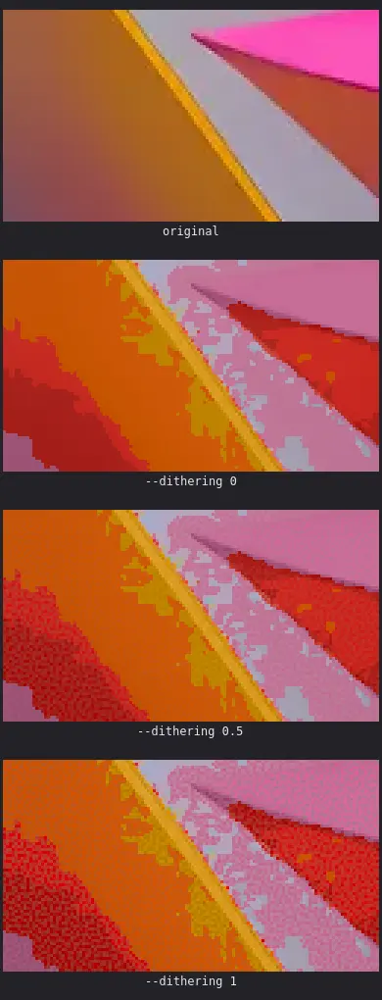
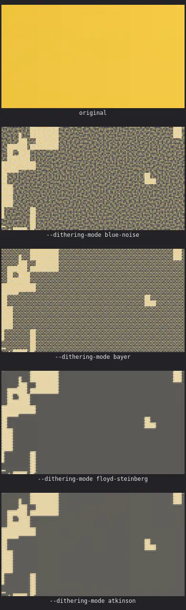
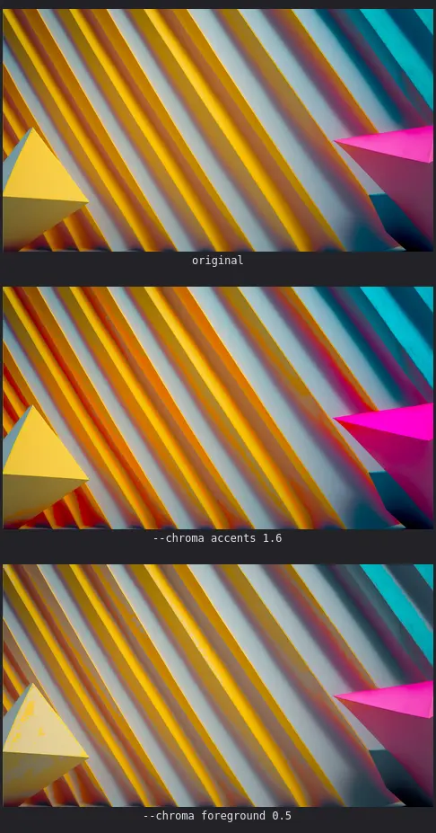
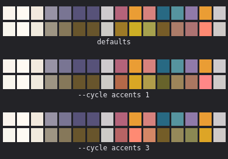
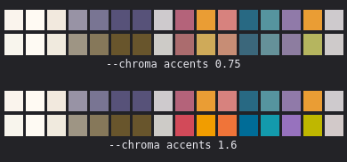
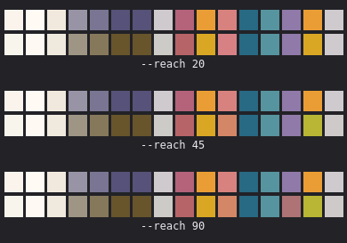

# Examples

Every dial, what it does, what values it takes, and a demo of a
generation actually turning. Each montage opens with the demo subject's
original image (where there is one), and each cell is labelled with the
flags that produced it; **the code block under each montage is the
recipe**, one command per cell. Recipes leave out the inputs, which are
the same for every montage of a command:

<!-- gen:ladder-bases -->
```sh
# scheme recipes run as:
rehue scheme -i rose-pine-dawn -w assets/kelly-ishmael-butterfly-closeup.webp -o out
# wal recipes run as:
rehue wal -i assets/bango-renders-3d-abstract.webp -s gruvbox-light -o out
# inspect recipes run as:
rehue inspect -w assets/kelly-ishmael-butterfly-closeup.webp -o out
```
<!-- /gen:ladder-bases -->

The montages and recipes are generated from
[docs/examples.toml](docs/examples.toml), so they always match.

- **wal** repaints [bango-renders-3d-abstract](assets/bango-renders-3d-abstract.webp)
  with Gruvbox Light (a few montages use another image that shows the
  option better; their recipe names its inputs). Every wal montage
  below opens with the original image, then applies only the option
  named, isolated, unless the
  option is inert on its own; then the recipe carries the companion
  dial it needs (mode, reach, max-gray-chroma, dithering, assign).
- **scheme** paints Rosé Pine Dawn with the hue families of
  [kelly-ishmael-butterfly-closeup](assets/kelly-ishmael-butterfly-closeup.webp)
  (below), also at defaults. The wallpaper is shown small because the
  scheme strip is the subject — the palette is what you are judging.
- **extraction** demos run `rehue inspect` on the butterfly.

<p></p>


Dials belong to **roles**: `background` (`bg`, base00), `surfaces`
(`sf`, base01-03), `foreground` (`fg`, base04-07), `accents` (`ac`,
base08-0F). A flag with a role writes that role's record, a bare flag
seeds `all`. Per-role `--config` records outrank the seeds; see
[Merge and precedence](#merge-and-precedence).

---

## wal (scheme → wallpaper)

Writes `wallpaper.png`, `compare.png` (before/after thumbnails),
`report.json` (per-slot pixel coverage). With all dials at zero the
output is a re-encoded passthrough.

### mode — `blend | snap`, default `blend`

| | |
| --- | --- |
| `blend` | every pixel's target is the palette's weighted mean under a smooth influence field (a Gaussian falloff on circular hue distance, lightness distance for gray pixels). Slot boundaries become smooth crossings; the flat-constant posterize look disappears by construction. |
| `snap` | nearest-slot snapping: pixels adopt exact palette colors and flat constants, the stylized, dithering-as-art mode. The match dials cut off at `reach`. |


<!-- gen:ladder:wal-mode -->
```sh
# blend (the default), harmonize 1
rehue wal --harmonize 1
# snap, harmonize 1
rehue wal --harmonize 1 --mode snap
```
<!-- /gen:ladder:wal-mode -->

### harmonize — `0..1`, default `0`

The one-dial surface (`-H`): sets `match-hue` and `match-chroma`
wherever they are left unset. Explicit dials win (so `-H 1
--match-chroma 0.5` moves hue at full strength but chroma at half);
`match-lightness` is never set by it, so lightness stays photographic
unless you opt in by name.


<!-- gen:ladder:wal-harmonize -->
```sh
rehue wal --harmonize 0.5
rehue wal --harmonize 1
```
<!-- /gen:ladder:wal-harmonize -->

### match-hue — `0..1`, default `0` (set by harmonize)

How much of the target hue colorful pixels take on: 0 = their own hue,
1 = full adoption.

On its own it is subtle: a scheme's sixteen colors cover most of the
hue wheel, so the nearest one is usually only a few degrees away, and
most of what harmonize visibly does comes from match-chroma. Against a
narrow palette the pull is plain to see, so the ladder runs it with a
two-color `--palette` (see [palette](#palette--slots-roles-or-all-with-weights)).


<!-- gen:ladder:wal-match-hue -->
```sh
rehue wal --palette base0D,base0E --match-hue 0.5
rehue wal --palette base0D,base0E --match-hue 1
```
<!-- /gen:ladder:wal-match-hue -->

### match-chroma — `0..1`, default `0` (set by harmonize)

How much of the target chroma pixels take on. This is the dial that
carries the "repaint" feel; harmonize sets it along with match-hue.


<!-- gen:ladder:wal-match-chroma -->
```sh
rehue wal --match-chroma 0.5
rehue wal --match-chroma 1
```
<!-- /gen:ladder:wal-match-chroma -->

### match-lightness — `0..1`, default `0`, independent

How much of the target lightness pixels take on. Deliberately never
set by harmonize: adopting
lightness flattens contrast and washes the image out — visible in the
ladder below at 0.5 and 1.0. Default 0 keeps the picture's own
lightness shape at every harmonize level.


<!-- gen:ladder:wal-match-lightness -->
```sh
rehue wal --match-lightness 0.5
rehue wal --match-lightness 1
```
<!-- /gen:ladder:wal-match-lightness -->

### reach — degrees, default `45`

How far influence reaches on the hue wheel. In `blend` mode it is
the falloff width (larger = farther slots pull on each pixel); in
`snap` it is the cutoff the match dials use. Shown paired with a full
`harmonize 1`, without which reach changes nothing.


<!-- gen:ladder:wal-reach -->
```sh
rehue wal --harmonize 1 --reach 15
# the default
rehue wal --harmonize 1 --reach 45
rehue wal --harmonize 1 --reach 140
```
<!-- /gen:ladder:wal-reach -->

### palette — slots, roles or `all`, with weights

Which scheme colors pixels may be pulled toward, and how hard. Keys
are slots (`base0D`), roles (`accents`, `ac`) or `all`; a bare key is
weight 1, `key=weight` sets it. Once a palette is given, **unlisted
slots are left out**, so `ac` means accents only (grays stay gray,
because no neutral slot is in), `base0D,base0E` is a duotone, and
`all,base0B=6` keeps everything but lets green reach farther. The
most specific key wins: a slot beats its role, a role beats `all`.

A weight divides the slot's hue distance, in both modes: a weight-2
slot pulls from twice as far in `blend` and claims an arc twice as
wide in `snap` (snap's `reach` cutoff still measures the real
distance). Weighting favors a color without taking the others away,
so it is gentler than leaving slots out. Weights belong to
slots, not hues: they apply after `assign` and `cycle`. In config:
`"palette": {"all": 1, "base0D": 6}`. A `--palette` flag replaces the
config's palette rather than merging with it.


<!-- gen:ladder:wal-palette -->
```sh
# every slot
rehue wal --harmonize 1
# accents only
rehue wal --harmonize 1 --palette ac
# duotone
rehue wal --harmonize 1 --palette base0D,base0E
# green reaches farther
rehue wal --harmonize 1 --palette all,base0B=6
```
<!-- /gen:ladder:wal-palette -->

### max-gray-chroma — default `0.02`

Chroma below which pixels count as gray: they key to the scheme's
low-chroma slots by lightness and **keep their own hue
unconditionally** (match-hue never touches them). Raising it pulls
pale pixels into the repainting earlier. Same companion as reach: the
effect only exists at nonzero match dials. Shown on the butterfly,
whose pale wings sit right around the threshold.


<!-- gen:ladder:wal-max-gray-chroma -->
```sh
# inputs: rehue wal -i assets/kelly-ishmael-butterfly-closeup.webp -s gruvbox-light -o out
# the default
rehue wal --harmonize 1 --max-gray-chroma 0.02
rehue wal --harmonize 1 --max-gray-chroma 0.1
```
<!-- /gen:ladder:wal-max-gray-chroma -->

### dithering — `0..1`, default `0`

Strength of the dither. Inert at zero adoption (no residual to spread)
and at full adoption (the target swallows the residual) — it exists
for the partial-adopt and snap looks. Companion declared: snap mode
with full match-hue and partial match-lightness / match-chroma.
Dithering is texture, so the cells show a 3× crop.



<!-- gen:ladder:wal-dithering -->
```sh
rehue wal --mode snap --match-hue 1 --match-lightness 0.5 --match-chroma 0.9 --dithering 0
rehue wal --mode snap --match-hue 1 --match-lightness 0.5 --match-chroma 0.9 --dithering 0.5
rehue wal --mode snap --match-hue 1 --match-lightness 0.5 --match-chroma 0.9 --dithering 1
```
<!-- /gen:ladder:wal-dithering -->

### dithering-mode — `blue-noise` (default) | `bayer` | `floyd-steinberg` | `atkinson` | `none`

The kernel the strength applies to: two ordered masks (void-and-cluster
blue noise, classic 8×8 Bayer) and two error-diffusion kernels
(serpentine scan, fixed order — no RNG). Floyd-Steinberg propagates
everything; Atkinson drops 2/8, which reads gentler (the two are close
cousins and look alike at a glance).



<!-- gen:ladder:wal-dithering-mode -->
```sh
rehue wal --mode snap --match-hue 1 --match-lightness 0.5 --match-chroma 0.9 --dithering 1 --dithering-mode blue-noise
rehue wal --mode snap --match-hue 1 --match-lightness 0.5 --match-chroma 0.9 --dithering 1 --dithering-mode bayer
rehue wal --mode snap --match-hue 1 --match-lightness 0.5 --match-chroma 0.9 --dithering 1 --dithering-mode floyd-steinberg
rehue wal --mode snap --match-hue 1 --match-lightness 0.5 --match-chroma 0.9 --dithering 1 --dithering-mode atkinson
```
<!-- /gen:ladder:wal-dithering-mode -->

### assign — per role

Before painting, gives the role's slots hues taken from the
wallpaper's families (lightness and chroma stay the scheme's).
Values: `auto` = the heaviest families spread across the role's
slots, `3` = every slot from family 3, `0,1,2,3` = explicit stops
(duplicates give flat runs; in JSON, `"auto"`, `3` or `[0, 1, 2, 3]`).
Family indices come from `rehue inspect`. Without a role only a family
index works: the single-slot background inherits `all`, so `auto` and
lists need a role. Shown on the glitter, whose many hues give the
families something to differ by.


<!-- gen:ladder:wal-assign -->
```sh
# inputs: rehue wal -i assets/vidsplay-rainbow-glitter.webp -s gruvbox-light -o out
# no assign
rehue wal --harmonize 1
# every accent from the heaviest family
rehue wal --harmonize 1 --assign accents 0
# the four heaviest across the accents
rehue wal --harmonize 1 --assign accents 0,1,2,3
```
<!-- /gen:ladder:wal-assign -->

### cycle — per role, integer

Moves each of the role's hues N slots along, wrapping around (slots,
not degrees); no-op for the single-slot background. Applies after
assign. In wal it barely shows: pixels find their slot by hue, so
after a cycle the same hues still land on the same colors, and only
which lightness and chroma go with each hue changes (visible with
match-lightness). It matters on the scheme side, where it decides
which slot gets which color (see [scheme cycle](#cycle--per-role-integer-1)).

### lightness / chroma — two depths

Bare: the **image-wide** grade, applied last (lightness added, chroma
multiplied). With a role (`--lightness bg -0.05`): that role's grade,
applied before the image-wide one.


<!-- gen:ladder:wal-lightness -->
```sh
rehue wal --lightness -0.1
rehue wal --lightness 0.1
```
<!-- /gen:ladder:wal-lightness -->


<!-- gen:ladder:wal-chroma -->
```sh
rehue wal --chroma 0.6
rehue wal --chroma 1.4
```
<!-- /gen:ladder:wal-chroma -->



<!-- gen:ladder:wal-role-grades -->
```sh
# harmonize alone
rehue wal --harmonize 1
rehue wal --harmonize 1 --chroma accents 2
rehue wal --harmonize 1 --lightness foreground 0.15
```
<!-- /gen:ladder:wal-role-grades -->

---

## scheme (wallpaper → scheme)

Writes `scheme.yaml`, `preview.png` (before/after swatches — the
strips below are exactly this artifact), `clusters.json` (extracted
families + params). The demo stage: butterfly → Rosé Pine Dawn.

### match-hue — `0..1`, default `1`

The whole point of `rehue scheme`: 1 = every slot adopts the mapped hue,
0 = the reference scheme verbatim. Between: the wallpaper's pull fades
by shortest-arc circular interpolation between the reference and
assigned hues.
(Note the direction difference from wal: there match-hue pulls pixels
*toward the scheme*; here slots pull *toward the wallpaper*.)


<!-- gen:ladder:scheme-match-hue -->
```sh
# match-hue 1, the default
rehue scheme
rehue scheme --match-hue 0.4
# the reference scheme verbatim
rehue scheme --match-hue 0
```
<!-- /gen:ladder:scheme-match-hue -->

### assign — per role

Replaces the default assignment (accents claim eligible families by
hue distance; every other role adopts the heaviest family) with
explicit family targeting: the same `auto` / index / list values as
wal.


<!-- gen:ladder:scheme-assign -->
```sh
# defaults: accents claim, the rest take the heaviest family
rehue scheme
rehue scheme --assign accents 0,1,2,3
# surfaces and foreground spread across the families
rehue scheme --assign surfaces auto --assign foreground auto
```
<!-- /gen:ladder:scheme-assign -->

### cycle — per role, integer

Applies after assign: the role's hues move N slots along.



<!-- gen:ladder:scheme-cycle -->
```sh
rehue scheme --assign accents 0,1,2,3
rehue scheme --assign accents 0,1,2,3 --cycle accents 1
rehue scheme --assign accents 0,1,2,3 --cycle accents 3
```
<!-- /gen:ladder:scheme-cycle -->

### lightness / chroma — per role

Lightness shift (added) and chroma scale (multiplied) for the role's
slots; the scheme's structure stays unless you ask.



<!-- gen:ladder:scheme-chroma -->
```sh
rehue scheme --chroma accents 0.75
rehue scheme --chroma accents 1.6
```
<!-- /gen:ladder:scheme-chroma -->

### reach — degrees, default `45`

The accent claim gate: how far a family hue may sit from an accent
slot's hue and still claim it. Widening lets more slots follow more
families; narrowing forces them back to the heaviest ones.



<!-- gen:ladder:scheme-reach -->
```sh
rehue scheme --reach 5
# the default
rehue scheme --reach 45
rehue scheme --reach 180
```
<!-- /gen:ladder:scheme-reach -->

---

## Extraction

The extraction stage finds the wallpaper's hue families —
chroma²-weighted hue histogram, then a deterministic circular
k-means (greedy histogram seeding, fixed iteration count, no RNG). It
feeds `rehue scheme`'s mapping and `assign` on both sides;
`rehue inspect` prints its output as the index table (with `-o`, a
swatch strip whose positions are the indices).

<!-- gen:extraction-table -->
| option | default | semantics |
| --- | --- | --- |
| `max-dimension` | 256 | work at this capped resolution (Lanczos resize) |
| `min-pixel-chroma` | 0.04 | ignore pixels below this chroma |
| `lightness-range` | [0.1, 0.92] | only pixels inside this lightness band vote |
| `max-families` | 6 | at most this many families survive |
| `seed-spacing` | 25 | histogram seeding: minimum separation between seeds |
| `iterations` | 30 | fixed k-means iteration count |
| `merge-within` | 18 | merge families closer than this |
| `min-family-weight` | 0.02 | drop families lighter than this mass |
| `min-accent-chroma` | 0.06 | a family must be at least this chromatic to claim an accent slot |
<!-- /gen:extraction-table -->

`max-families` narrowing what survives, on the butterfly (2 / 3 / 6):


<!-- gen:ladder:extract-max-families -->
```sh
# config.json: {"max-families":2}
rehue inspect --config config.json
# config.json: {"max-families":3}
rehue inspect --config config.json
# the default
# config.json: {"max-families":6}
rehue inspect --config config.json
```
<!-- /gen:ladder:extract-max-families -->

---

## Looks

A look is a saved grade (`-l NAME`; `rehue inspect --looks` lists
them, see the [README](README.md#looks) for writing your own). Each
cell below is one built-in look and nothing else.


<!-- gen:ladder:looks-wal -->
```sh
rehue wal -l soft
rehue wal -l tight
rehue wal -l pop
rehue wal -l muted
rehue wal -l snap
rehue wal -l vivid
```
<!-- /gen:ladder:looks-wal -->

The looks that grade schemes too, on the butterfly and Rosé Pine Dawn:


<!-- gen:ladder:looks-scheme -->
```sh
rehue scheme
rehue scheme -l soft
rehue scheme -l tight
rehue scheme -l pop
rehue scheme -l muted
```
<!-- /gen:ladder:looks-scheme -->

---

## Merge and precedence

Settings layer in this order, each one winning over the ones before
it, key by key:

1. the defaults,
2. the looks (`-l`, else the config's `look` key), left to right,
3. the `--config` file (or the pipeline table),
4. the flags.

Within each layer, config records resolve `globals // all // role`: bare flags seed
`all`, flags with a role (`--chroma bg 1.6`) write that role's record,
and `--config` JSON records do the same job, with one precedence rule
per key:

1. the role's own record (flag with a role, or config file),
2. else the `all` seed (bare flag or config `all` record),
3. else the role's default.

Only wal's bare `--lightness` / `--chroma` differ by design: they are
the image-wide grade, not a seed. Extraction options are config-JSON
only. Dithering is global-only: role records do not carry it. Role
names take their short forms in config keys too (`"bg"`, `"ac"`).
`palette` is the one key that replaces instead of merging: a palette
in a later layer replaces the earlier one whole. Unknown keys are
errors, in configs, looks and pipelines alike.

The workshop example, expressed twice:

```sh
# flags form
rehue scheme -i solarized-dark -w pic.webp -o out \
  --match-hue 1 \
  --chroma bg 1.6 --chroma sf 1.6 --chroma fg 1.6 --chroma ac 0.75 \
  --assign bg 1 --assign sf 1,3 --assign fg 0 \
  --assign ac 0,1,2,3
```

```json
{ "roles": {
    "all": {"match-hue": 1.0},
    "background": {"assign": 1, "chroma": 1.6},
    "surfaces": {"assign": [1, 3], "chroma": 1.6},
    "foreground": {"assign": 0, "chroma": 1.6},
    "accents": {"assign": [0, 1, 2, 3], "chroma": 0.75}
} }
```

Both run the same merge and the same engine; the JSON form wins when
the same dial needs the same value on several roles.
