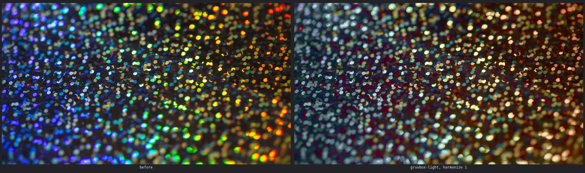
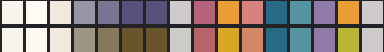
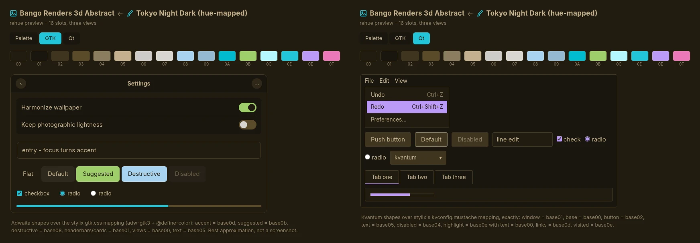
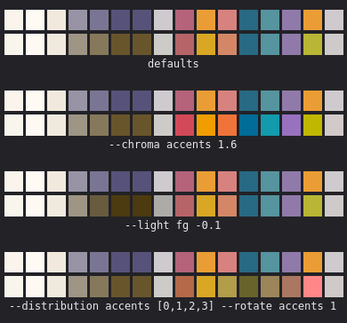
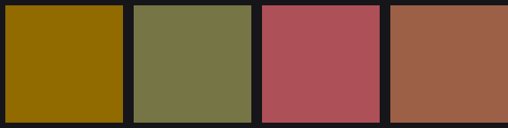

# rehue

*re-hue (verb): to color again differently.*

**Color grading for your desktop.** rehue maps base16 color schemes
and wallpapers onto each other: a terminal palette painted with your
wallpaper's hues, or a wallpaper repainted with your terminal's
palette. It is deterministic, it preserves legibility, and it lets you
grade the result instead of accepting whatever comes out.



## Why

You probably already have a wallpaper you love, or a color scheme you
love. Usually not both at once.

Most wallpaper-to-scheme generators give you presets: a palette built
from image clusters or a fixed design system, with a handful of
variants to pick from. You choose a preset, but you can't grade it,
re-order it, or emphasize the colors you actually like, and the scheme
you already love isn't part of the picture at all.

rehue keeps the scheme you already love and lets you grade it, in both
directions.

rehue splits the job in two:

- **Which hues** you get comes from the wallpaper.
- **How those hues are shaped** (lightness, chroma, contrast) comes
  from a scheme a designer already built: Solarized, Gruvbox, Rosé
  Pine, or any of the <!-- gen:scheme-count -->375<!-- /gen:scheme-count -->
  [tinted-theming](https://github.com/tinted-theming/schemes) schemes.

Then every part of it is a dial. Shift lightness on the accents only,
boost chroma on the surfaces, cycle which hue lands in which slot,
pin a favorite color to a specific slot. You build the pipeline to
your own spec, and it gives the same answer every time.

It works in both directions:

- **`rehue scheme`** (scheme + wallpaper → scheme): your scheme,
  rehued with the wallpaper's colors. It feels like your wallpaper
  but stays as readable as the scheme.
- **`rehue wal`** (wallpaper + scheme → wallpaper): your
  wallpaper, repainted with the scheme's palette. No more hunting for
  a wallpaper that matches. The picture you love becomes the one that
  matches.

Use both and the loop closes: rehue a scheme from your wallpaper, then
repaint the wallpaper with that scheme. Every command takes the thing
it rehues with `-i`; the other input is `-s` (a scheme) or `-w` (a
wallpaper).

## Quick start

```sh
cargo install rehue

# your scheme, rehued with your wallpaper's colors:
rehue scheme -i nord -w my-photo.jpg -o mapped
# writes mapped/scheme.yaml, plus previews (preview.png, preview.html)
# and the extraction report (clusters.json)

# your wallpaper, repainted with a scheme's palette:
rehue wal -i my-photo.jpg -s gruvbox-light -o repainted -H 1

# the round trip: repaint the wallpaper with the scheme you just made
rehue wal -i my-photo.jpg -s mapped/scheme.yaml -o repainted -H 1
```

Both commands print the palettes in your terminal as they finish. Add
`-n` (`--dry-run`) to preview a change without writing anything, which is
the fastest way to try out dials. `rehue inspect --schemes` shows
every bundled scheme with its colors (`--schemes gruvbox` filters).

## Examples

All inputs are in-repo assets (CC0, see
[assets/attribution.md](assets/attribution.md)).

### Rainbow glitter → Gruvbox Light

One dial: `--harmonize 1`. It moves the hue *and* chroma of every
pixel toward the palette, but leaves lightness alone, so the glitter
keeps its sparkle and trades its rainbow for Gruvbox's aqua, yellow
and orange (the image at the top of this page). Its brightest specks
reach the accents' full strength while the dim ones stay quiet: the
picture keeps its own range of color, inside the scheme's.

<!-- gen:run:glitter -->
```sh
rehue wal \
  -i assets/vidsplay-rainbow-glitter.webp \
  -s gruvbox-light \
  -o glitter \
  -H 1
```
<!-- /gen:run:glitter -->

The colors land spread wide: the scheme's darkest gray (the glitter's
black background) takes 39% of the pixels, the next slot about 11%,
and the rest single digits each. One palette, and still a photograph.

### Rosé Pine Dawn → Butterfly

No dials at all. rehue extracts the butterfly's hue families, weighted
by how colorful and how common they are, and assigns them slot by
slot. Rosé Pine Dawn's lightness, chroma and contrast are untouched.

<!-- gen:run:butterfly-mapped -->
```sh
rehue scheme \
  -i rose-pine-dawn \
  -w assets/kelly-ishmael-butterfly-closeup.webp \
  -o mapped
```
<!-- /gen:run:butterfly-mapped -->

<p></p>



And the other direction: the butterfly repainted with the scheme it
just produced.

<!-- gen:run:butterfly-repainted -->
```sh
rehue wal \
  -i assets/kelly-ishmael-butterfly-closeup.webp \
  -s mapped/scheme.yaml \
  -o repainted \
  -H 1
```
<!-- /gen:run:butterfly-repainted -->


### The full round trip

First, paint Tokyo Night Dark with the wallpaper's hues, at defaults:

<!-- gen:run:bango-mapped -->
```sh
rehue scheme \
  -i tokyo-night-dark \
  -w assets/bango-renders-3d-abstract.webp \
  -o mapped
```
<!-- /gen:run:bango-mapped -->

Scheme before (top) and after (bottom). Tokyo Night's structure is
kept; only the hues move:


Then feed the new scheme back into the image:

<!-- gen:run:bango-repainted -->
```sh
rehue wal \
  -i assets/bango-renders-3d-abstract.webp \
  -s mapped/scheme.yaml \
  -o repainted \
  -H 1
```
<!-- /gen:run:bango-repainted -->


The palette your terminal uses is now the palette the picture was
painted with.

### The preview page

Every `scheme` and `wal` run also writes `preview.html`, a
self-contained page (no scripts) that shows the scheme on a terminal, a
code block and common widgets, next to the wallpaper, so you can judge
it before wiring it in. This is the round trip's page:


Two more tabs approximate how Stylix maps the same 16 slots onto GTK
(Adwaita) and Qt (Kvantum):



## Guarantees

- **Deterministic.** There is no randomness anywhere, cluster seeding
  included. The same inputs produce byte-identical outputs, so results
  can be committed, diffed and built reproducibly.
- **Legibility preserving.** Every slot keeps the reference scheme's
  lightness and chroma unless you explicitly change them with a dial,
  and a final check restores text-vs-background contrast before
  anything is written.

## Grading

### Roles

A base16 scheme's 16 slots fall into four **roles**. Each has a short
form for typing; rehue prints the full names:

<!-- gen:roles -->
| role | short | slots | what it is |
| --- | --- | --- | --- |
| `background` | `bg` | base00 | the background |
| `surfaces` | `sf` | base01-03 | panels, selections, comments |
| `foreground` | `fg` | base04-07 | text |
| `accents` | `ac` | base08-0F | syntax colors, highlights, status colors |
<!-- /gen:roles -->

Every dial can apply to everything, or to one role:

```sh
rehue scheme ... --chroma 1.2                  # every role
rehue scheme ... --chroma accents 1.6          # accents only
rehue scheme ... --chroma ac 1.6 --lightness fg 0.05   # short forms, one per role
```

Each row below is the butterfly mapped onto Rosé Pine Dawn (the
reference on top, the result below), with one role changed at a time:



A role-specific setting always wins over the global one. For a
pipeline you want to keep, put the settings in a JSON file and pass
`-c` (`--config`); an `all` record there sets every role, and records
for named roles override it. Every dial is optional: with no config at
all you get sensible defaults.

[EXAMPLES.md](EXAMPLES.md) shows every dial turning, with the exact
command for each image, and covers how settings combine.

### Looks

A **look** is a saved grade you pick by name, so you don't have to
tune every dial yourself. The same `-l` works on both commands:

```sh
rehue wal -i wall.png -s gruvbox-light -l pop
rehue scheme -i rose-pine-dawn -w wall.png -l soft
rehue wal -i wall.png -s gruvbox-light -l snap,pop     # stacked, left to right
rehue inspect --looks                                  # list them
```

<!-- gen:looks -->
| look | grades | what it does |
| --- | --- | --- |
| `soft` | wal, scheme, icons | calm: a gentle harmony with a soft cast toward the scheme's grays |
| `tight` | wal, scheme, icons | the closest bond: palette hue, chroma and some of its lightness; scheme accents follow every family |
| `pop` | wal, scheme, icons | full harmony with the color turned up |
| `muted` | wal, scheme, icons | full harmony, softer color: calm, low-saturation results |
| `wash` | wal, icons | the palette washed over the image: everything leans toward the scheme's main accent colors |
| `snap` | wal, icons | exact accent hues and chroma, the image's own shading kept |
| `vivid` | wal, icons | accents only, at full strength: bold color, grays left alone |
<!-- /gen:looks -->

A look is a starting point: your `-c` config and your flags still win,
key by key (`-l pop --chroma 1` keeps pop's harmony but not its extra
color). Your own looks go in `~/.config/rehue/looks/NAME.toml`, with a
`[wal]` and/or `[scheme]` section taking the same keys as the configs;
a file named like a built-in replaces it, and a name with a `/` is a
path:

```toml
# ~/.config/rehue/looks/dusk.toml
description = "evening: quieter, a little darker"

[wal]
harmonize = 1
chroma = 0.8
lightness = -0.04

[scheme]
roles.all.chroma = 0.85
```

Configs and pipelines take `look` as a key too (`"look": "pop"`).
EXAMPLES.md shows [every built-in look](EXAMPLES.md#looks).

### Both directions

The two commands are the same move pointed opposite ways.
**scheme** pulls the palette toward the picture. **wal** pushes the
picture's pixels toward the palette.

#### scheme (wallpaper → scheme)

<!-- gen:flags:scheme:grading -->
| flag | value | what it does |
| --- | --- | --- |
| `--reach` | `DEG` | How far, in hue degrees, an accent can reach to claim a wallpaper hue (default 45) |
| `--assign` | `[ROLE] VAL` | Give a role's slots hues taken from the wallpaper's families: `auto` = spread the heaviest across, `3` = all from family 3, `0,2,5` = these families across the slots |
| `--cycle` | `[ROLE] N` | Move each of a role's hues N slots along, wrapping around (slots, not degrees) |
| `--match-hue` | `[ROLE] 0..1` | How much of the wallpaper's hue the slots take on, 0..1 (default 1) |
| `--lightness` | `[ROLE] L` | Shift a role's lightness (added; -0.1 is darker) |
| `--chroma` | `[ROLE] C` | Scale a role's chroma (multiplied; 0.8 muted, 1.3 vivid) |
<!-- /gen:flags:scheme:grading -->

Extraction settings go in the `--config` JSON (on `scheme`, `wal` or
`inspect`); [EXAMPLES.md](EXAMPLES.md#extraction) describes each:

<!-- gen:extraction-keys -->
`max-dimension`, `min-pixel-chroma`, `lightness-range`, `max-families`, `seed-spacing`, `iterations`, `merge-within`, `min-family-weight`, `min-accent-chroma`
<!-- /gen:extraction-keys -->

#### wal (scheme → wallpaper)

<!-- gen:flags:wal:grading -->
| flag | value | what it does |
| --- | --- | --- |
| `--mode` | `blend \| snap` | How pixels find their palette color: `blend` = mix the nearby palette colors, weighted by hue distance (default); `snap` = take the nearest one |
| `--neutrals` | `floor \| mix` | What the scheme's grays (base00-07) do for colorful pixels: `floor` = only set the lowest chroma in blend, and never catch a color in snap, so the image keeps its color structure (default); `mix` = join in like any slot, a calmer cast faded toward the scheme's grays |
| `--harmonize` | `0..1` | How strongly to harmonize with the scheme, 0..1: sets match-hue and match-chroma wherever they aren't set (default 0) |
| `--match-hue` | `[ROLE] 0..1` | How much of the palette's hue each pixel takes on (0 = keep its own, 1 = fully adopt) |
| `--match-chroma` | `[ROLE] 0..1` | How much of the palette's chroma each pixel takes on (0 = keep its own, 1 = fully adopt) |
| `--match-lightness` | `[ROLE] 0..1` | How much of the palette's lightness each pixel takes on (default 0, which keeps the image photographic) |
| `--reach` | `DEG` | How far, in hue degrees, a palette color's pull extends (default 45) |
| `--palette` | `KEY[=W],...` | Which scheme colors pixels may be pulled toward, and how hard: slots (base0D), roles (ac) or all, comma-separated, each bare (weight 1) or KEY=WEIGHT |
| `--max-gray-chroma` | `C` | Below this chroma a pixel counts as gray (default 0.02) |
| `--cycle` | `[ROLE] N` | Move each of a role's hues N slots along, wrapping around (slots, not degrees) |
| `--lightness` | `[ROLE] L` | Lightness shift (added). Bare: the whole-image grade, applied last; with a role: that role's grade |
| `--chroma` | `[ROLE] C` | Chroma scale (multiplied). Bare: the whole-image grade, applied last; with a role: that role's grade |
| `--assign` | `[ROLE] VAL` | Before painting, give a role's slots hues taken from the wallpaper's families: `auto` = spread the heaviest across, `3` = all from family 3, `0,2,5` = these families across the slots |
| `--dithering` | `0..1` | Dithering strength 0..1 (0 = off) |
| `--dithering-mode` | `blue-noise \| bayer \| floyd-steinberg \| atkinson \| none` | Dithering pattern (default blue-noise) |
<!-- /gen:flags:wal:grading -->

#### LUT export

`wal --lut hald` (or `--lut cube`) also bakes the grade into a 3D
lookup table, `lut.png` (Hald CLUT) or `lut.cube`, so other tools can
apply exactly the same grade to other images or to video:

```sh
rehue wal -i wall.webp -s mapped/scheme.yaml -o graded \
  -H 1 --lut hald --lut-level 16

magick photo.jpg graded/lut.png -hald-clut photo-graded.jpg          # ImageMagick
ffmpeg -i clip.mp4 -i graded/lut.png -filter_complex '[0][1]haldclut' out.mp4   # ffmpeg
```

`--lut-level` sets the resolution (default 8, i.e. 64 points per
channel; `.cube` goes up to 8). At level 16 the Hald LUT covers every
8-bit color, and ImageMagick reproduces rehue's own output pixel for
pixel; lower levels are interpolated by the tool applying them. Needs
`dithering` 0, because a dithered pixel depends on its position, not
just its color.

## Commands

<!-- gen:commands -->
| command | what it does |
| --- | --- |
| `rehue scheme` | Scheme + wallpaper → scheme: adopt the wallpaper's hues, keep the scheme's structure |
| `rehue wal` | Wallpaper + scheme → wallpaper: repaint the image with the scheme's palette |
| `rehue icons` | Recolor an icon theme (or one SVG / PNG icon) with a scheme |
| `rehue inspect` | Show a wallpaper's hue families, a scheme's colors, or every scheme (`--schemes`) in the terminal |
| `rehue enhance` | Upscale a wallpaper: built-in Lanczos, or Vulkan AI super-resolution |
| `rehue apply` | Run a pipeline file and apply the result: scheme to tinty, wallpaper to your command |
<!-- /gen:commands -->

`--help` on any command prints every option with what it does, the
values it accepts and an example; `-h` shows the short form. `-o`
(`--out`) defaults to `rehue-out`. The everyday flags have short
forms:

| flag | means |
| --- | --- |
| `-i` | the input: whatever the command names (`wal -i` a wallpaper, `scheme -i` a scheme, `enhance -i` an image) |
| `-s` / `-w` | the other input: a scheme / a wallpaper |
| `-o` | output directory |
| `-c` | config JSON |
| `-n` | dry run: preview, write nothing |
| `-H` | `--harmonize` |
| `-p` | `--palette` (wal) |
| `-l` | `--look` |

### Choosing a scheme

A scheme (`scheme -i`, `wal -s`, `inspect -s`) is either a
**name** from the bundled collection (all <!-- gen:scheme-count -->375<!-- /gen:scheme-count -->
[tinted-theming](https://github.com/tinted-theming/schemes) base16
schemes, the same set Stylix uses) or a **path** to a scheme YAML.

To use your own collection, pass `--scheme-dir`: names are looked up
there first, then in the bundled set.

### inspect

`inspect` shows you what rehue sees.

**Wallpaper mode** lists the image's hue families with their index,
hue, chroma and weight, above a row of truecolor swatches in the same
order. The indices are what `assign` refers to.

<!-- gen:run:inspect-butterfly -->
```sh
rehue inspect \
  -w assets/kelly-ishmael-butterfly-closeup.webp \
  -o inspect
```
<!-- /gen:run:inspect-butterfly -->

The butterfly's four families, indices 0 to 3 left to right:



**Scheme mode** shows all 16 slots as truecolor swatches, four per
line, in canonical order:

```sh
rehue inspect -s gruvbox-light      # by name
rehue inspect -s my-theme.yaml      # by path
```

With `-o DIR`, wallpaper mode also writes `inspect.png` (the swatch
row) and scheme mode writes `preview.html` (the same mock page
`scheme` produces).

### icons

Recolor a whole icon theme with your scheme. Every color in the theme
gets the same grade a wallpaper gets from `wal`, so the icons, the
wallpaper and the apps all land in one palette:

```sh
rehue icons -i Papirus-Dark -s gruvbox-light
cp -r rehue-out/Papirus-Dark-rehue ~/.local/share/icons/
```

Then pick `Papirus-Dark-rehue` in your desktop's icon settings (on
GNOME: `gsettings set org.gnome.desktop.interface icon-theme
Papirus-Dark-rehue`). `rehue-out/preview.png` shows familiar icons
before and after, so you can judge the grade first. `-i` takes a theme
name from your icon directories, a theme directory, or a single `.svg`
/ `.png` icon; `--name` sets the new theme's name.

**Set the folder color** with `--folders`, which takes a scheme color
(or several, like `-p`) and paints only the folder icons; everything
else is graded as usual:

```sh
rehue icons -i Papirus-Dark -s gruvbox-light --folders base0E
```

**Make a one-color icon pack** with `-p`: every icon is painted in the
scheme colors you name, keeping its own shading.

```sh
rehue icons -i Papirus-Dark -s gruvbox-light -p base0D           # one color
rehue icons -i Papirus-Dark -s gruvbox-light -p base0D,base0E    # two
```

**Pick a look** for the overall feel: `-l snap` puts every color
exactly on an accent and keeps whites white, `-l wash` leans every
icon toward the scheme's main accent colors, `-l pop` / `-l muted`
turn the color up or down. All the `wal` grading flags work too:

<!-- gen:flags:icons:grading -->
| flag | value | what it does |
| --- | --- | --- |
| `--folders` | `KEY[=W],...` | The folder color: which scheme colors folder icons are painted with, in the --palette form (a slot, a role, weights). Folders are the theme's Places icons named folder*, plus user-home, user-desktop and inode-directory; the rest of the theme is graded as usual |
| `--mode` | `blend \| snap` | How pixels find their palette color: `blend` = mix the nearby palette colors, weighted by hue distance (default); `snap` = take the nearest one |
| `--neutrals` | `floor \| mix` | What the scheme's grays (base00-07) do for colorful pixels: `floor` = only set the lowest chroma in blend, and never catch a color in snap, so the image keeps its color structure (default); `mix` = join in like any slot, a calmer cast faded toward the scheme's grays |
| `--harmonize` | `0..1` | How strongly to harmonize with the scheme, 0..1: sets match-hue and match-chroma wherever they aren't set (default 0) |
| `--match-hue` | `[ROLE] 0..1` | How much of the palette's hue each pixel takes on (0 = keep its own, 1 = fully adopt) |
| `--match-chroma` | `[ROLE] 0..1` | How much of the palette's chroma each pixel takes on (0 = keep its own, 1 = fully adopt) |
| `--match-lightness` | `[ROLE] 0..1` | How much of the palette's lightness each pixel takes on (default 0, which keeps the image photographic) |
| `--reach` | `DEG` | How far, in hue degrees, a palette color's pull extends (default 45) |
| `--palette` | `KEY[=W],...` | Which scheme colors pixels may be pulled toward, and how hard: slots (base0D), roles (ac) or all, comma-separated, each bare (weight 1) or KEY=WEIGHT |
| `--max-gray-chroma` | `C` | Below this chroma a pixel counts as gray (default 0.02) |
| `--cycle` | `[ROLE] N` | Move each of a role's hues N slots along, wrapping around (slots, not degrees) |
| `--lightness` | `[ROLE] L` | Lightness shift (added). Bare: the whole-image grade, applied last; with a role: that role's grade |
| `--chroma` | `[ROLE] C` | Chroma scale (multiplied). Bare: the whole-image grade, applied last; with a role: that role's grade |
<!-- /gen:flags:icons:grading -->

Notes:

- Only the theme you name is recolored. A theme that takes some icons
  from another one (Numix-Circle takes its folders from Numix) needs
  that one recolored too; rehue says so when it happens.
- SVG and PNG icons are recolored, including PNGs embedded in SVGs.
  Icons KDE colors at runtime keep following KDE there and take the
  scheme everywhere else.
- Links inside the theme stay links, so the result is about the size of
  the original. If GTK's gtk-update-icon-cache is installed, the icon
  cache is rebuilt.

## Install

### With cargo

The image codecs (png/jpeg/webp) are pure Rust, so a stock Rust
toolchain (1.88 or newer) is all you need.

```sh
cargo install rehue
```

Or the latest unreleased code, from a clone
([`rust-toolchain.toml`](rust-toolchain.toml) lets rustup pick the
right version automatically):

```sh
git clone https://github.com/fortesoft-co/rehue
cd rehue
cargo install --path .
```

### With Nix

```nix
inputs.rehue.url = "github:fortesoft-co/rehue";
```

The flake provides the package, a devshell with the pinned toolchain
(`nix develop`), and builders for wiring rehue into your config.

### Stylix

The Nix builders run the whole pipeline inside the build sandbox. The
mapped scheme feeds `stylix.base16Scheme`, the repainted wallpaper
feeds `stylix.image`, and GTK, Firefox, Zed, terminals and GNOME all
restyle from one store path. Nothing reads global state and nothing
touches the network. The outputs (scheme YAML, PNG, extraction report)
commit and diff like the rest of your config, so your scheme and the
picture it came from can never drift apart.

```nix
# in a module:
let
  mapped = rehue.lib.${system}.scheme {
    wallpaper = ./assets/glitter.webp;
    scheme = "${pkgs.base16-schemes}/share/themes/gruvbox-light.yaml";
    # config = { roles.foreground = { match-hue = 0.4; chroma = 0.85; }; };
  };
  repainted = rehue.lib.${system}.wal {
    wallpaper = ./assets/glitter.webp;
    scheme = "${mapped}/scheme.yaml";
    config = { harmonize = 1.0; };
  };
in {
  stylix.base16Scheme = "${mapped}/scheme.yaml";
  stylix.image = "${repainted}/wallpaper.png";
}
```

Icon themes work the same way. `lib.icons` recolors a theme from any
icon package and gives back a package for `stylix.icons`:

```nix
let
  icons = rehue.lib.${system}.icons {
    icons = pkgs.papirus-icon-theme;
    theme = "Papirus-Dark";
    scheme = "${mapped}/scheme.yaml";
    name = "Papirus-Rehue";
    # config = { folders = { base0E = 1; }; };   # the folder color
  };
in {
  stylix.icons = {
    enable = true;
    package = icons;
    dark = "Papirus-Rehue";
    light = "Papirus-Rehue";
  };
}
```

Set both `dark` and `light`: Stylix's GTK and Qt targets each pick one.
The preview sheet is in `${icons}/share/rehue/preview.png`. Inside a
Nix build only built-in looks are available; a look of your own works
by path (`config.look = "${./dusk.toml}";`).

### Apply (without Nix)

`rehue apply` runs a whole pipeline from one TOML file and hands the
result to your desktop. rehue makes the colors and the wallpaper;
[tinty](https://github.com/tinted-theming/tinty) renders the scheme
into every app you've set up in it (terminals, shells, editors, bars),
using the tinted-theming templates.

**Prerequisite:** a working tinty setup. rehue hands tinty the scheme,
but which apps get themed, and how each one picks up its theme (an
import line in the app's config, or a hook), is tinty's configuration.
See tinty's [README](https://github.com/tinted-theming/tinty#readme)
and [USAGE](https://github.com/tinted-theming/tinty/blob/main/USAGE.md)
to set it up; each template repo's README shows the matching config
line or hook for its apps.

```toml
# ~/.config/rehue/pipeline.toml
wallpaper = "~/Pictures/glitter.webp"
scheme = "gruvbox-light"        # a bundled name, or a path to yaml
# out = "~/.local/share/rehue/current"   (the default)

[rehue]
look = "pop"                    # both steps start from a look (optional)

[rehue.scheme]                  # rehue the scheme (empty = the look / defaults)
[rehue.scheme.roles.accents]
chroma = 1.2

[rehue.wal]                     # repaint the wallpaper with it
harmonize = 1.0

[apply]
wallpaper-command = "swww img {wallpaper}"
```

```sh
rehue apply --pipeline ~/.config/rehue/pipeline.toml -n   # preview
rehue apply --pipeline ~/.config/rehue/pipeline.toml
```

- **Steps:** `[rehue.scheme]` and `[rehue.wal]` take the same keys as their
  JSON `--config` files; a table being present turns that step on.
  With both, the wallpaper is repainted with the scheme it just
  produced (the round trip). With only `[rehue.wal]`, the reference
  scheme is applied as-is. `look` under `[rehue]` starts both steps
  from a look; a step's own `look` key replaces it, and the table's
  keys win over either.
- **tinty:** the scheme is installed as a tinty custom scheme
  (`<tinty data dir>/custom-schemes/base16/rehue.yaml`) and applied
  with `tinty apply base16-rehue`; tinty then builds and installs the
  themes and runs your hooks. Needs **tinty 0.35 or newer** (older
  versions can't build themes for custom schemes). `tinty-name`
  changes the name, `tinty = false` skips tinty, and `tinty-config` /
  `tinty-data-dir` point it at another setup (handy for trying things
  without touching your real one).
- **Wallpaper:** `wallpaper-command` runs through `sh` with
  `{wallpaper}` replaced by the (quoted) image path; `$REHUE_WALLPAPER`
  and `$REHUE_SCHEME` are set too. Any setter works: swww, swaybg,
  feh, `gsettings set org.gnome.desktop.background picture-uri ...`.
- **Paths** in the file resolve against the file's directory (`~/`
  expands), and commands run from there. Outputs (`scheme/`,
  `wallpaper/`, previews) land in `out`.

## Roadmap

- **Apply, next steps**: `rehue apply` v1 hands off to tinty.
  - *Native rendering* (evaluation): render tinted-theming templates
    directly (e.g. with the `tinted-builder` library), so apply works
    without tinty and templates can render inside a Nix build. Also
    investigate whether Stylix's per-app targets can be reused, so Nix
    and non-Nix setups style apps the same way.
  - *Hooks* (investigation): tinty already runs per-app hooks; decide
    what, if anything, rehue should own beyond `wallpaper-command`.
  - *Patch* (investigation, opt-in only): rewriting colors in place
    inside existing CSS/config files, as lutgen's `patch` does. Never
    the default path: fidelity is uncertain and in-place writes can
    break files, so at minimum diff-first with explicit confirmation.
- **Scheme browser**: pick a scheme by eye from `inspect --schemes`.
  First step: page through `$PAGER` (`less -R`) when stdout is a
  terminal, as git does, with `--no-pager`; pipes stay plain. Later: an
  interactive browser (ratatui) with a live preview of the selected
  scheme (its terminal colors, or the wallpaper repainted).
- **TOML and YAML configs**: `-c` reads JSON today; accept `.toml`
  and `.yaml` too (picked by file extension), so a config can be
  written in the same format as the `apply` pipeline or a scheme.
- **WCAG contrast mode**: a contrast-ratio option for `rehue scheme`
  (e.g. 4.5:1, the ratio theme designers check against) alongside the
  lightness-gap guard `min-text-contrast`, and possibly covering more
  foreground slots than base05.
- **Scheme generation**: the big one. Derive the lightness/chroma/
  contrast structure a designer would have built, guided by the
  wallpaper, so `rehue scheme` works without a reference scheme at all.
- **ADVANCED_EXAMPLES.md**: the complex combinations kept out of the
  main docs (assign across roles, reach tuning, colorize
  recipes), each with the images to prove it.
- **base24 coverage**: slots base10-17.
- **Media formats**: more inputs beyond png / jpeg / webp (gif, tiff,
  bmp, qoi, avif where a pure-Rust decoder allows), and animated
  GIF / APNG / WebP (LUT export already makes per-frame repaints a
  table lookup).
- **Alternative extraction backends**: optional extraction libraries
  alongside the built-in histogram + circular k-means (the options
  themselves are documented in [EXAMPLES.md](EXAMPLES.md#extraction)).
- **Enhance expansion**: beyond v1 (Lanczos + Vulkan SR): denoise and
  JPEG-artifact restoration models (Real-CUGAN / realesrnet), a
  low-strength img2img restyle (sd.cpp) as a creative pass, and an
  opt-in Nix SR builder (lavapipe for machines without a GPU driver).
- **Performance**: the per-pixel wal pass is single-threaded.
  Non-dithered and ordered-dither modes parallelize cleanly (each
  pixel depends only on x, y), which should bring a 33MP remap from
  ~18s to ~2-3s; error-diffusion dithering stays sequential by nature.
  For non-dithered runs, a LUT (already built across threads for
  `--lut`) is the other fast path: build once, then look up.

## Development

```sh
# with your rustup toolchain:
cargo test
cargo build --release

# with Nix (pinned toolchain):
nix develop -c cargo test
nix develop -c cargo build --release
nix build .#rehue
```

`cargo test` runs the snapshot and determinism suites.

The bundled schemes are a vendored snapshot of
[tinted-theming/schemes](https://github.com/tinted-theming/schemes)
(MIT, see `vendor/tinted-schemes/LICENSE`), pinned to the commit
recorded in `vendor/tinted-schemes/SOURCE`. base24 files are included
for the base24 roadmap item but not used yet. To refresh before a
release (it re-runs the scheme tests, so a malformed upstream scheme
fails here):

```sh
nix develop -c scripts/update-schemes.sh            # upstream HEAD
nix develop -c scripts/update-schemes.sh <commit>   # or a pinned commit/tag
```

The docs are partly generated, and `cargo test` keeps them honest.
Reference tables, example commands and counts sit between
`<!-- gen:NAME -->` markers and render from the code; everything
outside the markers is hand-written. A test fails when a region is
stale, or when the hand-written text names a flag or option that
doesn't exist:

```sh
REHUE_BLESS=1 cargo test --test docs    # re-render every region
```

Every image in the docs, and the command that made it, is defined once
in `docs/examples.toml`. The builder runs the commands and assembles
the images (the `examples` devshell adds imagemagick and headless
chromium); `docs/examples.lock` records what was built, so a test fails
when an example changes without a rebuild:

```sh
nix develop .#examples -c cargo run --release --example docs-images
nix develop .#examples -c cargo run --release --example docs-images -- wal-mode   # just one
```

```
src/color.rs     sRGB/OKLab/OKLCH + circular-hue math (one source of truth)
src/scheme.rs    base16 YAML parse/render + slot access + name resolution
src/extract.rs   chroma^2 hue histogram + deterministic circular k-means
src/role.rs      the four roles, their names, and assign (shared by both directions)
src/grade_scheme.rs  rehue scheme: the per-role pipeline and its options
src/grade_wal.rs     rehue wal: the per-colour remap (ColorMap) + mode + dithering
src/lut.rs       Hald CLUT / .cube export of a colour function
src/terminal.rs  truecolor ANSI strips for inspect (scheme + families modes)
src/enhance.rs   enhance: Lanczos + vulkan SR (realesrgan-ncnn-vulkan)
src/preview.rs   the compiled-in preview.html (css-only views; gtk/qt mocks)
src/bluenoise.rs embedded 64x64 void-and-cluster mask (CC0)
src/apply.rs     apply: pipeline files, the tinty handoff, the wallpaper command
src/cli.rs       the CLI's commands, flags and help (the docs render from it)
src/bin/rehue.rs the CLI's command handlers
build.rs         embeds vendor/tinted-schemes as the bundled scheme table
vendor/          tinted-theming/schemes snapshot (scripts/update-schemes.sh)
docs/            examples.toml (every docs image + command), its lock, manifest.rs
examples/        docs-images: builds the docs images from docs/examples.toml
tests/           per-surface suites: extraction, grade_scheme, grade_wal,
                 scheme, terminal, enhance, preview, cli, apply, lut,
                 docs (generated regions + drift check) (+ common/ helpers)
```

## License

AGPL-3.0-or-later. See [LICENSE](LICENSE).
