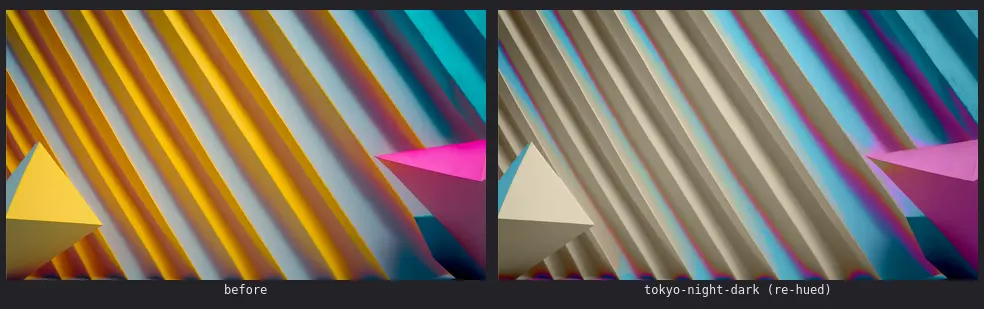

# rehue

*re-hue (verb): to color again differently.*

**Color grading for your desktop.** rehue maps base16 color schemes
and wallpapers onto each other: a terminal palette painted with your
wallpaper's hues, or a wallpaper repainted with your terminal's
palette. It is deterministic, it preserves legibility, and it lets you
grade the result instead of accepting whatever comes out.


## Why

You probably already have a wallpaper you love, or a color scheme you
love. Usually not both at once.

Most wallpaper-to-scheme generators hand you one palette at one
contrast level. They build it from raw image clusters with no contrast
guarantees, so the results are often muddy, and there is no way to
grade it, re-order it, or emphasize the colors you actually like.

rehue splits the job in two:

- **Which hues** you get comes from the wallpaper.
- **How those hues are shaped** (lightness, chroma, contrast) comes
  from a scheme a designer already built: Solarized, Gruvbox, Rosé
  Pine, or any of the 361
  [tinted-theming](https://github.com/tinted-theming/schemes) schemes.

Then every part of it is a dial. Shift lightness on the accents only,
boost chroma on the surfaces, rotate which hue lands in which slot,
pin a favorite color to a specific slot. You build the pipeline to
your own spec, and it gives the same answer every time.

It works in both directions:

- **`rehue map-scheme`** (scheme + wallpaper → scheme): your scheme,
  re-hued with the wallpaper's colors. It feels like your wallpaper
  but stays as readable as the scheme.
- **`rehue map-wal`** (wallpaper + scheme → wallpaper): your
  wallpaper, repainted with the scheme's palette. No more hunting for
  a wallpaper that matches. The picture you love becomes the one that
  matches.

Use both and the loop closes: map a scheme from your wallpaper, then
repaint the wallpaper with that scheme.

## Quick start

```sh
cargo install --git https://github.com/fortesoft-co/rehue

# your scheme, re-hued with your wallpaper's colors:
rehue map-scheme --wallpaper my-photo.jpg --scheme nord --out mapped
# writes mapped/scheme.yaml, plus previews (preview.png, preview.html)
# and the extraction report (clusters.json)

# your wallpaper, repainted with a scheme's palette:
rehue map-wal --wallpaper my-photo.jpg --scheme gruvbox-light --out repainted --harmonize 1

# the round trip: repaint the wallpaper with the scheme you just made
rehue map-wal --wallpaper my-photo.jpg --scheme mapped/scheme.yaml --out repainted
```

Both commands print the palettes in your terminal as they finish. Add
`--dry-run` to preview a change without writing anything, which is
the fastest way to try out dials. `rehue schemes` lists every bundled
scheme by name.

## Examples

All inputs are in-repo assets (CC0, see
[assets/attribution.md](assets/attribution.md)).

### Rainbow glitter → Gruvbox Light

One dial: `--harmonize 1`. It moves the hue *and* chroma of every
pixel toward the palette, but leaves lightness alone, so the glitter
keeps its sparkle and loses its rainbow (the image at the top of this
page).

```sh
rehue map-wal \
  --wallpaper assets/vidsplay-rainbow-glitter.webp \
  --scheme gruvbox-light \
  --out glitter \
  --harmonize 1
```

The colors land spread wide: the scheme's brightest surface covers 39%
of the pixels, the next about 11%, and the rest single digits each. One
palette, and still a photograph.

### Rosé Pine Dawn → Butterfly

No dials at all. rehue extracts the butterfly's hue families, weighted
by how colorful and how common they are, and assigns them slot by
slot. Rosé Pine Dawn's lightness, chroma and contrast are untouched.

```sh
rehue map-scheme \
  --wallpaper assets/kelly-ishmael-butterfly-closeup.webp \
  --scheme rose-pine-dawn \
  --out mapped
```

<p></p>


And the other direction: the butterfly repainted with the scheme it
just produced.

```sh
rehue map-wal \
  --wallpaper assets/kelly-ishmael-butterfly-closeup.webp \
  --scheme mapped/scheme.yaml \
  --out repainted \
  --harmonize 1
```


### The full round trip

First, paint Tokyo Night Dark with the wallpaper's hues, at defaults:

```sh
rehue map-scheme \
  --wallpaper assets/bango-renders-3d-abstract.webp \
  --scheme tokyo-night-dark.yaml \
  --out mapped
```

Scheme before (top) and after (bottom). Tokyo Night's structure is
kept; only the hues move:


Then feed the new scheme back into the image:

```sh
rehue map-wal \
  --wallpaper assets/bango-renders-3d-abstract.webp \
  --scheme mapped/scheme.yaml \
  --out repainted \
  --harmonize 1
```



The palette your terminal uses is now the palette the picture was
painted with.

### The preview page

Every `map-scheme` and `map-wal` run also writes `preview.html`, a
self-contained page (no scripts) that shows the scheme on a terminal, a
code block and common widgets, next to the wallpaper, so you can judge
it before wiring it in. This is the round trip's page:


Two more tabs approximate how Stylix maps the same 16 slots onto GTK
(Adwaita) and Qt (Kvantum):


## Guarantees

- **Deterministic.** There is no randomness anywhere, cluster seeding
  included. The same inputs produce byte-identical outputs, so results
  can be committed, diffed and built reproducibly.
- **Legibility preserving.** Every slot keeps the reference scheme's
  lightness and chroma unless you explicitly change them with a dial,
  and a final check restores text-vs-background contrast before
  anything is written.

## Grading

### Color groups

A base16 scheme's 16 slots fall into four groups, which rehue calls
**registers**:

| register | slots | what it is |
| --- | --- | --- |
| `bg` | base00 | the background |
| `surfaces` | base01-03 | panels, selections, comments |
| `fg` | base04-07 | text |
| `accents` | base08-0F | syntax colors, highlights, status colors |

Every dial can apply to everything, or to one group:

```sh
rehue map-scheme ... --chroma 1.2             # every group
rehue map-scheme ... --chroma accents 1.6     # accents only
rehue map-scheme ... --chroma accents 1.6 --light fg 0.05   # repeat per group
```

Each row below is the butterfly mapped onto Rosé Pine Dawn (the
reference on top, the result below), with one group changed at a time:


A group-specific setting always wins over the global one. For a
pipeline you want to keep, put the settings in a JSON file and pass
`--config`; an `all` record there sets every group, and records for
named groups override it. Every dial is optional: with no config at
all you get sensible defaults.

[EXAMPLES.md](EXAMPLES.md) shows every dial turning, with the exact
command for each image, and covers how settings combine.

### Both directions

The two commands are the same move pointed opposite ways.
**map-scheme** pulls the palette toward the picture. **map-wal**
pushes the picture's pixels toward the palette.

#### Shared (both commands)

| option | what it does |
| --- | --- |
| `distribution` | which wallpaper hue families go to which slots (JSON: `true` = spread across, `3` = pin to family 3, `[0,1,2,3]` = explicit list) |
| `rotate` | rotate a group's hues across its slots (`1` = one step right, wraps around) |

Family numbers come from `rehue inspect --wallpaper` (below).

#### map-scheme (wallpaper → scheme)

| option | what it does |
| --- | --- |
| `blend-hue` | how far slots adopt the wallpaper's hues, 0..1 (default 1) |
| `reach-deg` | how far, in hue degrees, an accent can reach to claim a wallpaper hue (default 45) |
| `light` / `chroma` | shift lightness (added) / scale chroma (multiplied), per group |

Extraction settings (via `--config` on `map-scheme` or `inspect`):
`image-max-dimension`, `chroma-pixel-floor`, `lightness-window`,
`max-hues`, `seed-separation-deg`, `cluster-iterations`, `merge-deg`,
`min-cluster-weight`, `accent-chroma-floor`, `fg-contrast-floor`.

#### map-wal (scheme → wallpaper)

| option | what it does |
| --- | --- |
| `harmonize` | one-dial shortcut: sets `blend-hue` and `blend-chroma` wherever they aren't set (default 0) |
| `blend-hue` / `blend-chroma` | how far pixel hue / chroma move toward the palette (0 = untouched, 1 = full snap) |
| `blend-light` | how far pixel lightness moves (default 0, which keeps the image photographic) |
| `territory` | `soft`: each palette color pulls nearby pixels with smooth falloff (default). `hard`: pixels snap to flat palette colors |
| `reach-deg` | how far, in hue degrees, a palette color's pull extends (default 45) |
| `gray-chroma-floor` | below this chroma a pixel counts as gray (default 0.02) |
| `dithering` / `dithering-mode` | dithering strength 0..1 (0 = off) / pattern (default blue-noise) |
| `light` / `chroma` | final whole-image grade, applied last (lightness added, chroma multiplied) |

## Commands

| command | what it does |
| --- | --- |
| `rehue map-scheme` | scheme + wallpaper → scheme |
| `rehue map-wal` | wallpaper + scheme → wallpaper |
| `rehue enhance` | upscale a wallpaper: built-in Lanczos, or Vulkan AI super-resolution |
| `rehue inspect` | show a wallpaper's hue families or a scheme's colors in the terminal |
| `rehue schemes` | list the bundled scheme names |

`--help` on any command prints every option with what it does, the
values it accepts and an example; `-h` shows the short form. `--out`
defaults to `rehue-out`.

### Choosing a scheme

`--scheme` (on `map-scheme`, `map-wal` and `inspect`) takes either a
**name** from the bundled collection (all 361
[tinted-theming](https://github.com/tinted-theming/schemes) base16
schemes, the same set Stylix uses) or a **path** to a scheme YAML.

To use your own collection, pass `--scheme-dir`: names are looked up
there first, then in the bundled set.

### inspect

`inspect` shows you what rehue sees.

**Wallpaper mode** lists the image's hue families with their index,
hue, chroma and weight, above a row of truecolor swatches in the same
order. The indices are what `distribution` refers to.

```sh
rehue inspect --wallpaper butterfly.webp
```

The butterfly's four families, indices 0 to 3 left to right:


**Scheme mode** shows all 16 slots as truecolor swatches, four per
line, in canonical order:

```sh
rehue inspect --scheme gruvbox-light      # by name
rehue inspect --scheme my-theme.yaml      # by path
```

With `--out DIR`, wallpaper mode also writes `inspect.png` (the swatch
row) and scheme mode writes `preview.html` (the same mock page
`map-scheme` produces).

## Install

### With cargo

The image codecs (png/jpeg/webp) are pure Rust, so a stock Rust
toolchain (1.85 or newer, edition 2024) is all you need.
[`rust-toolchain.toml`](rust-toolchain.toml) lets rustup pick the
right version automatically.

```sh
git clone https://github.com/fortesoft-co/rehue
cd rehue
cargo install --path .
```

### With Nix

```nix
inputs.rehue.url = "github:fortesoft-co/rehue";
```

The flake provides the package, a devshell with the pinned toolchain
(`nix develop`), and builders for wiring rehue into your config.

### Stylix

The Nix builders run the whole pipeline inside the build sandbox. The
mapped scheme feeds `stylix.base16Scheme`, the repainted wallpaper
feeds `stylix.image`, and GTK, Firefox, Zed, terminals and GNOME all
restyle from one store path. Nothing reads global state and nothing
touches the network. The outputs (scheme YAML, PNG, extraction report)
commit and diff like the rest of your config, so your scheme and the
picture it came from can never drift apart.

```nix
# in a module:
let
  mapped = rehue.lib.${system}.mapScheme {
    wallpaper = ./assets/glitter.webp;
    scheme = "${pkgs.base16-schemes}/share/themes/gruvbox-light.yaml";
    # registers = { fg = { blend-hue = 0.4; chroma = 0.85; }; };
  };
  repainted = rehue.lib.${system}.mapWal {
    wallpaper = ./assets/glitter.webp;
    scheme = "${mapped}/scheme.yaml";
    config = { harmonize = 1.0; };
  };
in {
  stylix.base16Scheme = "${mapped}/scheme.yaml";
  stylix.image = "${repainted}/wallpaper.png";
}
```

Not on Nix? rehue's output is a standard base16 YAML, so any base16
tool (for example [tinty](https://github.com/tinted-theming/tinty))
can apply it today. A built-in `rehue apply` is on the roadmap.

## Roadmap

- **Apply outside Nix**: a `rehue apply` step for non-Nix setups.
  Render the mapped scheme through base16 templates (the
  tinted-theming template format, so existing templates work as-is),
  set the repainted wallpaper (swww / swaybg / feh / gsettings), and
  run per-app reload hooks, all from one config file, so the pipeline
  you define is the pipeline that runs.
- **Scheme generation**: the big one. Derive the lightness/chroma/
  contrast structure a designer would have built, guided by the
  wallpaper, so map-scheme works without a reference scheme at all.
- **Scheme bundle snapshot**: a release-time build step that pulls
  tinted-theming/schemes at a pinned commit and compiles it into the
  binary, replacing the git dependency. This unblocks
  `cargo install rehue` from crates.io, and the pinned commit keeps
  the bundle reproducible.
- **ADVANCED_EXAMPLES.md**: the complex combinations kept out of the
  main docs (distribution across groups, reach tuning, colorize
  recipes), each with the images to prove it.
- **base24 coverage**: slots base10-17.
- **Alternative extraction backends**: optional extraction libraries
  alongside the built-in histogram + circular k-means (the options
  themselves are documented in [EXAMPLES.md](EXAMPLES.md#extraction)).
- **Enhance expansion**: beyond v1 (Lanczos + Vulkan SR): denoise and
  JPEG-artifact restoration models (Real-CUGAN / realesrnet), a
  low-strength img2img restyle (sd.cpp) as a creative pass, and an
  opt-in Nix SR builder (lavapipe for machines without a GPU driver).
- **Performance**: the per-pixel map-wal pass is single-threaded.
  Non-dithered and ordered-dither modes parallelize cleanly (each
  pixel depends only on x, y), which should bring a 33MP remap from
  ~18s to ~2-3s; error-diffusion dithering stays sequential by nature.

## Development

```sh
# with your rustup toolchain:
cargo test
cargo build --release

# with Nix (pinned toolchain):
nix develop -c cargo test
nix develop -c cargo build --release
nix build .#rehue
```

`cargo test` runs the snapshot and determinism suites.

The README's images are generated, not hand-made. To regenerate all of
them from the current code (the `examples` devshell adds imagemagick
and headless chromium):

```sh
nix develop .#examples -c scripts/readme-examples.sh
```

```
src/color.rs     sRGB/OKLab/OKLCH + circular-hue math (one source of truth)
src/scheme.rs    base16 YAML parse/render + slot access + name resolution
src/extract.rs   chroma^2 hue histogram + deterministic circular k-means
src/register.rs  map-scheme: the register pipeline and its options
src/map_wal.rs   map-wal: per-pixel blend/grade + territory + dithering
src/terminal.rs  truecolor ANSI strips for inspect (scheme + families modes)
src/enhance.rs   enhance: Lanczos + vulkan SR (realesrgan-ncnn-vulkan)
src/preview.rs   the compiled-in preview.html (css-only views; gtk/qt mocks)
src/bluenoise.rs embedded 64x64 void-and-cluster mask (CC0)
src/bin/rehue.rs the CLI
tests/           per-surface suites: extraction, map_scheme, map_wal,
                 scheme, terminal, enhance, preview, cli (+ common/ helpers)
```

## License

AGPL-3.0-or-later. See [LICENSE](LICENSE).
