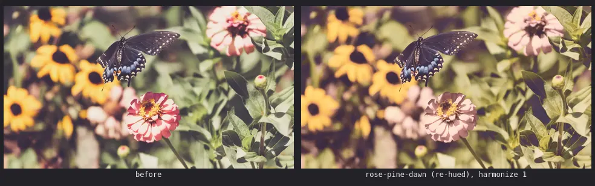
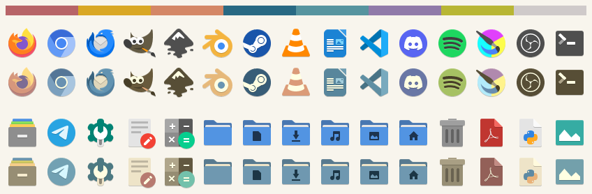
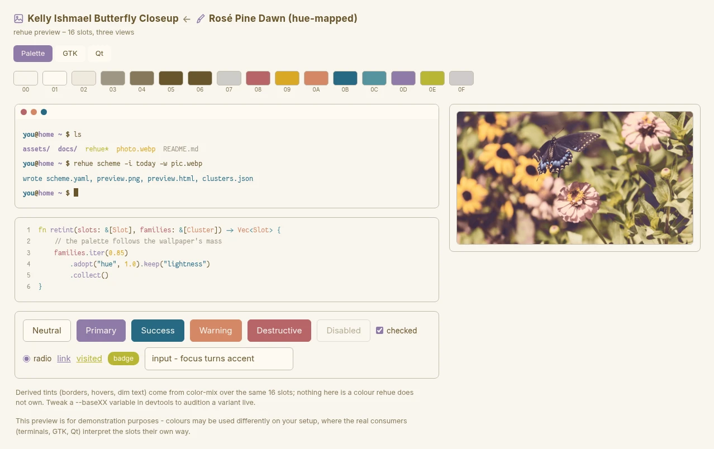

# rehue

*re-hue (verb): to color again differently.*

**Color grading for your desktop.** rehue maps base16 color schemes
and wallpapers onto each other: a terminal palette painted with your
wallpaper's hues, or a wallpaper repainted with your terminal's
palette, and your icon theme along with it. It is deterministic, it
preserves legibility, and it lets you grade the result instead of
accepting whatever comes out.



## Why

You probably already have a wallpaper you love, or a color scheme you
love. Usually not both at once.

Most wallpaper-to-scheme generators give you presets: a palette built
from image clusters or a fixed design system, with a handful of
variants to pick from. You choose a preset, but you can't grade it,
re-order it, or emphasize the colors you actually like, and the scheme
you already love isn't part of the picture at all.

rehue keeps the scheme you already love and lets you grade it, in both
directions.

rehue splits the job in two:

- **Which hues** you get comes from the wallpaper.
- **How those hues are shaped** (lightness, chroma, contrast) comes
  from a scheme a designer already built: Solarized, Gruvbox, Rosé
  Pine, or any of the <!-- gen:scheme-count -->375<!-- /gen:scheme-count -->
  [tinted-theming](https://github.com/tinted-theming/schemes) schemes.

Then every part of it is a dial. Shift lightness on the accents only,
boost chroma on the surfaces, cycle which hue lands in which slot,
pin a favorite color to a specific slot. You build the pipeline to
your own spec, and it gives the same answer every time.

It works in both directions:

- **`rehue scheme`** (scheme + wallpaper → scheme): your scheme,
  rehued with the wallpaper's colors. It feels like your wallpaper
  but stays as readable as the scheme.
- **`rehue wal`** (wallpaper + scheme → wallpaper): your
  wallpaper, repainted with the scheme's palette. No more hunting for
  a wallpaper that matches. The picture you love becomes the one that
  matches.

Use both and the loop closes: rehue a scheme from your wallpaper, then
repaint the wallpaper with that scheme. Every command takes the thing
it rehues with `-i`; the other input is `-s` (a scheme) or `-w` (a
wallpaper).

## Quick start

```sh
cargo install rehue

# your scheme, rehued with your wallpaper's colors:
rehue scheme -i nord -w my-photo.jpg -o mapped
# writes mapped/scheme.yaml, plus previews (preview.png, preview.html)
# and the extraction report (clusters.json)

# your wallpaper, repainted with a scheme's palette:
rehue wal -i my-photo.jpg -s gruvbox-light -o repainted -H 1

# the round trip: repaint the wallpaper with the scheme you just made
rehue wal -i my-photo.jpg -s mapped/scheme.yaml -o repainted -H 1

# and an icon theme to match
rehue icons -i Papirus-Dark -s mapped/scheme.yaml -o icons
```

`scheme` and `wal` print the palettes in your terminal as they
finish. Add `-n` (`--dry-run`) to preview a change without writing
anything, which is the fastest way to try out dials.

## Example

One butterfly, three steps. The butterfly is in the repo; the icons
are the Papirus theme (credits in
[assets/attribution.md](assets/attribution.md)).

<p></p>

**1. A scheme from the butterfly.** rehue finds the butterfly's hue
families and gives them to Rosé Pine Dawn, slot by slot. Rosé Pine
Dawn's lightness, chroma and contrast are untouched:

<!-- gen:run:butterfly-mapped -->
```sh
rehue scheme \
  -i rose-pine-dawn \
  -w assets/kelly-ishmael-butterfly-closeup.webp \
  -o mapped
```
<!-- /gen:run:butterfly-mapped -->


**2. The butterfly in that scheme.** The wallpaper, repainted with the
scheme it just produced:

<!-- gen:run:butterfly-repainted -->
```sh
rehue wal \
  -i assets/kelly-ishmael-butterfly-closeup.webp \
  -s mapped/scheme.yaml \
  -o repainted \
  -H 1
```
<!-- /gen:run:butterfly-repainted -->


**3. Icons to match.** Papirus, recolored with the same scheme
(before above, after below):

<!-- gen:run:butterfly-icons -->
```sh
rehue icons \
  -i Papirus \
  -s mapped/scheme.yaml \
  -o icons
```
<!-- /gen:run:butterfly-icons -->



Every `scheme` and `wal` run also writes `preview.html`, a
self-contained page that shows the scheme on a terminal, a code block
and common widgets next to the wallpaper, so you can judge it before
wiring it in. This is the butterfly's:



Two more tabs approximate how Stylix maps the same 16 slots onto GTK
(Adwaita) and Qt (Kvantum):


## Guarantees

- **Deterministic.** There is no randomness anywhere, cluster seeding
  included. The same inputs produce byte-identical outputs, so results
  can be committed, diffed and built reproducibly.
- **Legibility preserving.** Every slot keeps the reference scheme's
  lightness and chroma unless you explicitly change them with a dial,
  and a final check restores text-vs-background contrast before
  anything is written.

## Commands

<!-- gen:commands -->
| command | what it does |
| --- | --- |
| `rehue scheme` | Scheme + wallpaper → scheme: adopt the wallpaper's hues, keep the scheme's structure |
| `rehue wal` | Wallpaper + scheme → wallpaper: repaint the image with the scheme's palette |
| `rehue icons` | Recolor an icon theme (or one SVG / PNG icon) with a scheme |
| `rehue inspect` | Show a wallpaper's hue families, a scheme's colors, or every scheme (`--schemes`) in the terminal |
| `rehue enhance` | Upscale a wallpaper: built-in Lanczos, or Vulkan AI super-resolution |
| `rehue apply` | Run a pipeline file and apply the result: scheme to tinty, wallpaper to your command |
<!-- /gen:commands -->

`--help` on any command prints every option with what it does, the
values it accepts and an example; `-h` shows the short form. `-o`
(`--out`) defaults to `rehue-out`. The everyday flags have short
forms:

| flag | means |
| --- | --- |
| `-i` | the input: whatever the command names (`wal -i` a wallpaper, `scheme -i` a scheme, `icons -i` an icon theme) |
| `-s` / `-w` | the other input: a scheme / a wallpaper |
| `-o` | output directory |
| `-c` | config file |
| `-n` | dry run: preview, write nothing |
| `-H` | `--harmonize` |
| `-p` | `--palette` (wal, icons) |
| `-l` | `--look` |

A scheme is a name from the bundled collection (all
<!-- gen:scheme-count -->375<!-- /gen:scheme-count -->
[tinted-theming](https://github.com/tinted-theming/schemes) base16
schemes) or a path to a scheme YAML.

## scheme

`rehue scheme` paints a scheme with a wallpaper's colors. The
wallpaper decides which hues the scheme gets; the scheme keeps its
lightness, chroma and contrast.

```sh
rehue scheme -i nord -w my-photo.jpg                     # at defaults
rehue scheme -i nord -w my-photo.jpg --match-hue 0.5     # halfway to the wallpaper
rehue scheme -i nord -w my-photo.jpg --chroma ac 1.3     # brighter accents
```

More: [docs/scheme.md](docs/scheme.md), every option with examples.

## wal

`rehue wal` repaints a wallpaper with a scheme's palette, keeping the
picture's own lightness. `--harmonize` (`-H`) is the main dial: 0
leaves the image alone, 1 moves every color fully into the scheme.

```sh
rehue wal -i my-photo.jpg -s gruvbox-light -H 1                  # repaint
rehue wal -i my-photo.jpg -s gruvbox-light -H 1 --reach 90       # wash more of the palette over it
rehue wal -i my-photo.jpg -s gruvbox-light -H 1 -p base0D,base0E # only these two colors
```

More: [docs/wal.md](docs/wal.md), every option with examples, and
LUT export for other tools and video.

## icons

`rehue icons` recolors an icon theme with the same grade `wal` gives a
wallpaper, so the icons match it and the apps.

```sh
rehue icons -i Papirus -s gruvbox-light                     # recolor
rehue icons -i Papirus -s gruvbox-light --folders base0E    # purple folders
rehue icons -i Papirus -s gruvbox-light -p base0D           # only the scheme blue
```

Copy `rehue-out/Papirus-rehue` to `~/.local/share/icons/` and
pick it in your icon settings. More: [docs/icons.md](docs/icons.md).

## inspect

`rehue inspect` shows what rehue sees: a wallpaper's hue families, a
scheme's colors, every bundled scheme, or the looks.

```sh
rehue inspect -w my-photo.jpg         # the wallpaper's hue families
rehue inspect -s gruvbox-light        # a scheme's 16 colors
rehue inspect --schemes gruvbox       # every bundled scheme matching a name
```

More: [docs/inspect.md](docs/inspect.md).

## Looks

A look is a saved grade you pick by name with `-l`, on `wal`,
`scheme` and `icons`. Looks stack left to right, and your own config
and flags still win over them:

```sh
rehue wal -i my-photo.jpg -s gruvbox-light -l pop
rehue scheme -i nord -w my-photo.jpg -l soft
rehue inspect --looks                 # list them
```

The built-ins are <!-- gen:look-names -->`soft`, `tight`, `pop`, `muted`, `wash`, `snap` and `vivid`<!-- /gen:look-names -->. More:
[docs/looks.md](docs/looks.md), each one shown, and how to write your
own.

## Grading and config

A scheme's 16 slots fall into four roles (`background`, `surfaces`,
`foreground`, `accents`), and most dials take one, so you can grade
the accents without touching the text:

```sh
rehue scheme -i nord -w my-photo.jpg --chroma accents 1.3 --lightness fg 0.05
```

A grade you want to keep goes in a config file (TOML, YAML or JSON),
passed with `-c`.
More: [docs/grading.md](docs/grading.md) for roles and extraction,
[docs/config.md](docs/config.md) for config files and how settings
combine.

## Install

With cargo (Rust 1.88 or newer; the image codecs are pure Rust):

```sh
cargo install rehue
```

With Nix:

```nix
inputs.rehue.url = "github:fortesoft-co/rehue";
```

The flake also has builders that run rehue inside a Nix build, for
Stylix's scheme, wallpaper and icons. More:
[docs/nix.md](docs/nix.md).

## Apply

`rehue apply` runs a pipeline from one TOML file (rehue the scheme,
repaint the wallpaper) and hands the result to your desktop: the
scheme to [tinty](https://github.com/tinted-theming/tinty), which
themes your apps, and the wallpaper to your wallpaper command.

```sh
rehue apply --pipeline ~/.config/rehue/pipeline.toml -n   # preview
rehue apply --pipeline ~/.config/rehue/pipeline.toml
```

More: [docs/apply.md](docs/apply.md), the pipeline file and the tinty
setup.

## Docs

| page | what's in it |
| --- | --- |
| [scheme](docs/scheme.md) | `rehue scheme`: every option, with examples |
| [wal](docs/wal.md) | `rehue wal`: every option, with examples; LUT export |
| [icons](docs/icons.md) | `rehue icons`: folder colors, chosen-color packs, looks |
| [inspect](docs/inspect.md) | `rehue inspect`; choosing a scheme |
| [looks](docs/looks.md) | the built-in looks, shown; writing your own |
| [grading](docs/grading.md) | roles and extraction, shared by both directions |
| [config](docs/config.md) | config files, and how looks, configs and flags combine |
| [nix](docs/nix.md) | the flake, Stylix, icon themes |
| [apply](docs/apply.md) | pipelines, tinty, the wallpaper command |
| [development](docs/development.md) | building, testing, the generated docs |
| [roadmap](ROADMAP.md) | what may come next |
| [changelog](CHANGELOG.md) | what changed in each release |

## License

AGPL-3.0-or-later. See [LICENSE](LICENSE).
