# Dithering

`rehue wal --dither` draws the result with the scheme's colors only,
as a visible pattern: the checkerboards of 16-color games, the halftone
dots of print, drawn hatching, or the speckle of early-Mac pictures. It
runs last, after any grade, so it works with every other option, and on
its own it turns the image as it is into the scheme's colors. Every
pixel of the result is one of the scheme's colors, or one of the
`--palette` you chose.

```sh
rehue wal -i wall.png -s gruvbox-light --dither                  # checker at its defaults
rehue wal -i wall.png -s gruvbox-light -H 1 --dither halftone    # print dots
rehue wal -i wall.png -s gruvbox-light -l pc98                   # a look: harmonize, then dither
```

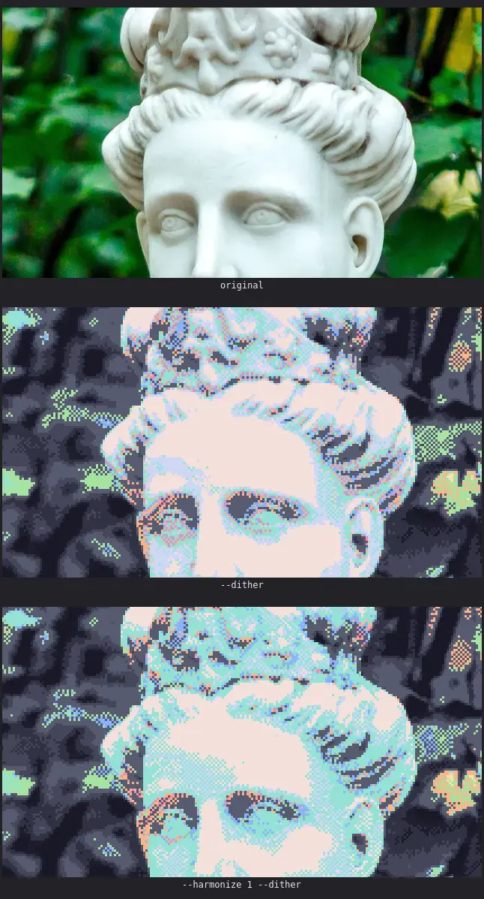

<!-- gen:ladder:wal-dither -->
```sh
# inputs: rehue wal -i assets/tamula-aura-garden-bust.webp -s catppuccin-mocha -o out
# the image as it is, in the scheme's colors
rehue wal --dither
# graded first, then dithered (the pc98 look)
rehue wal --harmonize 1 --dither
```
<!-- /gen:ladder:wal-dither -->

A bare `--dither` is the `checker` style at its defaults. Settings go
after the style in the `--palette` form,
`--dither halftone,size=12,angle=15`; in a config, as a table:

```toml
[dither]
style = "halftone"
size = 12
angle = 15
```

A setting the style doesn't take is an error that lists the ones it
does.

The examples on this page are 1:1 crops, since a dither pattern blurs
away when a picture is shrunk to fit a page. They use a marble
[garden bust](../assets/tamula-aura-garden-bust.webp), whose smooth
shading shows every setting, and the looks also run on an
[anime frame](../assets/honeyworks-anime-video-frame.webp) with flat
colors and clean outlines; both with Catppuccin Mocha. Credits are in
[assets/attribution.md](../assets/attribution.md).

## Looks

The quickest way in is a [look](looks.md):

- `pc98`: harmonize, then checker. The 16-color game look.
- `newsprint`: two inks, the scheme's background and text colors, in
  halftone dots.
- `onebit`: the scheme's darkest and lightest colors in Atkinson
  dithering. The early-Mac look.
- `hatch`: harmonize, then hatching tiles.

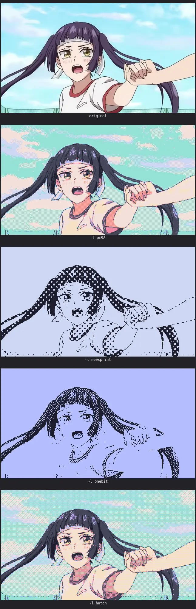

<!-- gen:ladder:looks-dither-anime -->
```sh
# inputs: rehue wal -i assets/honeyworks-anime-video-frame.webp -s catppuccin-mocha -o out
rehue wal -l pc98
rehue wal -l newsprint
rehue wal -l onebit
rehue wal -l hatch
```
<!-- /gen:ladder:looks-dither-anime -->

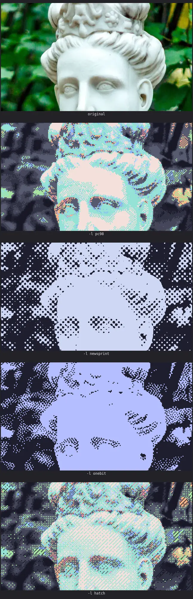

<!-- gen:ladder:looks-dither-bust -->
```sh
# inputs: rehue wal -i assets/tamula-aura-garden-bust.webp -s catppuccin-mocha -o out
rehue wal -l pc98
rehue wal -l newsprint
rehue wal -l onebit
rehue wal -l hatch
```
<!-- /gen:ladder:looks-dither-bust -->

## Styles

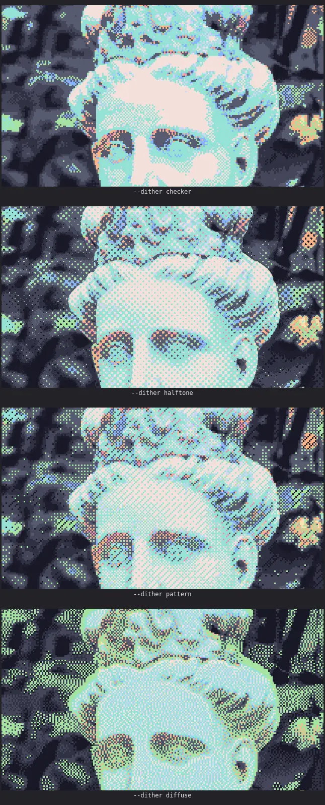

<!-- gen:ladder:wal-dither-styles -->
```sh
# inputs: rehue wal -i assets/tamula-aura-garden-bust.webp -s catppuccin-mocha -o out
rehue wal --harmonize 1 --dither checker
rehue wal --harmonize 1 --dither halftone
rehue wal --harmonize 1 --dither pattern
rehue wal --harmonize 1 --dither diffuse
```
<!-- /gen:ladder:wal-dither-styles -->

| style | how the in-between tones are drawn | look |
| --- | --- | --- |
| `checker` (default) | dispersed dots from a small grid | 16-color games |
| `halftone` | round dots growing from the centers of an angled grid | print |
| `pattern` | drawn tiles that fill in line by line | hatching |
| `diffuse` | each pixel's difference pushed on to its neighbors | early-Mac pictures |

The three grid styles draw each pattern pixel with two of the scheme's
colors, and how far the pixel sits between them decides, by its place
in the grid, which of the two it takes. `checker` mixes two colors only
where a pixel sits well between them, so most of the picture stays
solid and the pattern lives in the transitions, as pixel artists drew
it. `halftone` and `pattern` mix across the whole range from the
lighter color (the paper) to the darker (the ink), so dots and lines
grow smoothly from nothing to solid, as in print. `diffuse` takes the
nearest color for every pixel and passes what it got wrong on to the
pixels not yet drawn.

### Settings every grid style takes

**scale**: pattern pixel size. How many image pixels each pattern pixel
covers. `auto` aims for about 640 pattern pixels across, the PC-98's
own width: 3 on a 1920 px wallpaper, 6 on a 4K one, 1 on a small image.
A whole number sets it. `halftone` defaults to 1, since print is fine
grained; the others to `auto`. `diffuse` takes `scale` too.

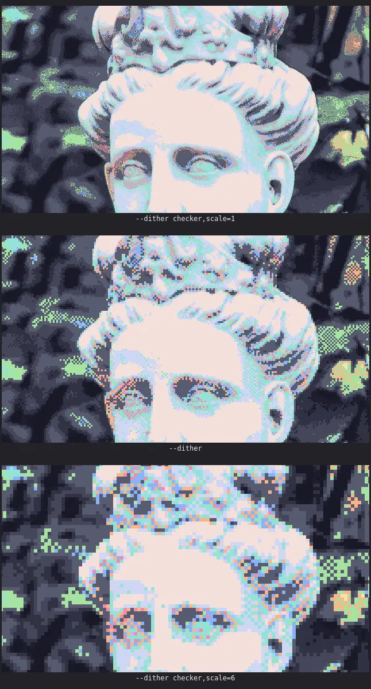

<!-- gen:ladder:wal-dither-scale -->
```sh
# inputs: rehue wal -i assets/tamula-aura-garden-bust.webp -s catppuccin-mocha -o out
rehue wal --dither checker,scale=1
# scale=auto: 3 on this 1920 px image
rehue wal --dither
rehue wal --dither checker,scale=6
```
<!-- /gen:ladder:wal-dither-scale -->

**sample**: `block` (default) or `pixel`. Where each pattern pixel gets
its color. `block` averages the block it covers, so the picture becomes
true big pixels: the period look, where thin lines dissolve into the
blocks. `pixel` keeps each image pixel's own color under the coarse
pattern, so outlines stay sharp and only the shading turns to pattern.

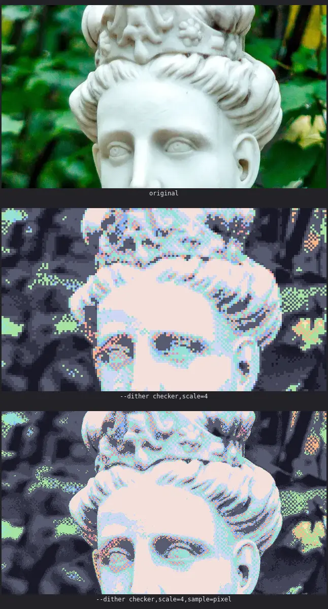

<!-- gen:ladder:wal-dither-sample -->
```sh
# inputs: rehue wal -i assets/tamula-aura-garden-bust.webp -s catppuccin-mocha -o out
# sample=block, the default
rehue wal --dither checker,scale=4
rehue wal --dither checker,scale=4,sample=pixel
```
<!-- /gen:ladder:wal-dither-sample -->

**flat**: `0..1`, how much stays solid. 0 patterns wherever two colors
meet; 1 is plain posterized color with no pattern. For `checker` it is
the share of the mixing band kept solid from the nearer color's side:
the default 0.5 keeps the checkerboards and drops the sparse single
dots, so large areas read as flat color. For `halftone` and `pattern`
it is the share of the paper-to-ink range kept solid, half at each end
(default 0.2), so the lightest areas stay clean paper and the darkest
solid ink.

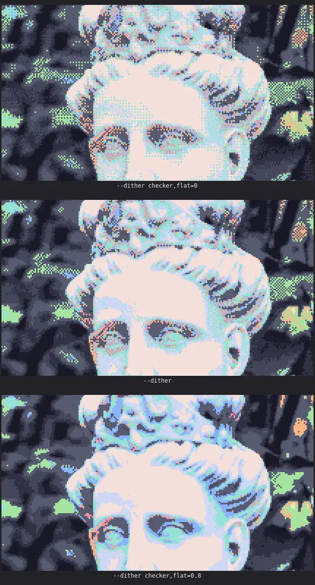

<!-- gen:ladder:wal-dither-flat -->
```sh
# inputs: rehue wal -i assets/tamula-aura-garden-bust.webp -s catppuccin-mocha -o out
rehue wal --dither checker,flat=0
# flat=0.5, the default
rehue wal --dither
rehue wal --dither checker,flat=0.8
```
<!-- /gen:ladder:wal-dither-flat -->

## checker

**size**: `2` (default), `4` or `8`, the grid. 2 gives the classic
checkerboard and its half steps; 4 adds quarter steps, finer and
busier; 8 adds still finer steps, rarely visible at pattern-pixel
sizes.

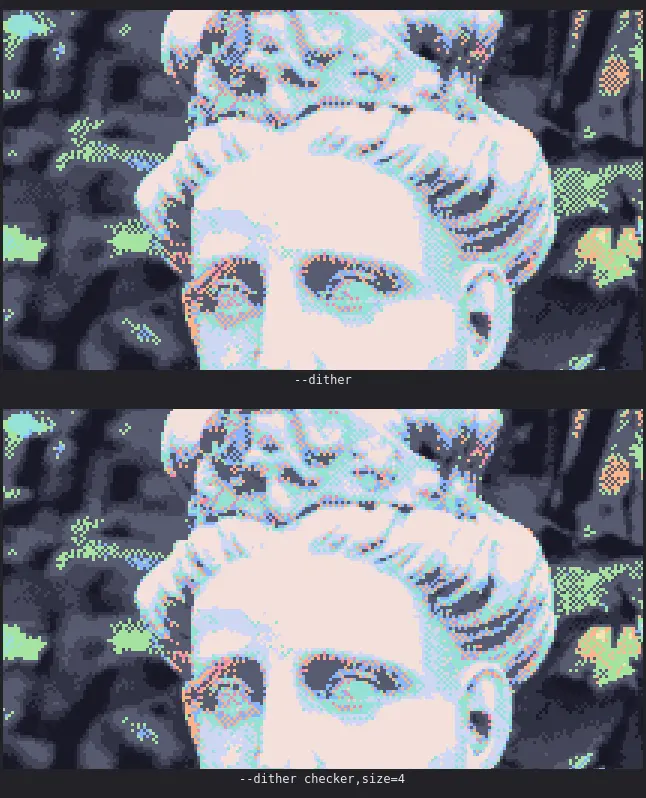

<!-- gen:ladder:wal-dither-size -->
```sh
# inputs: rehue wal -i assets/tamula-aura-garden-bust.webp -s catppuccin-mocha -o out
# size=2, the default
rehue wal --dither
rehue wal --dither checker,size=4
```
<!-- /gen:ladder:wal-dither-size -->

## halftone

**size**: the dot cell in pattern pixels, `3..32` (default 8). Bigger
cells, bigger dots, coarser print. **angle**: the screen angle in
degrees, `0..90` (default 45, the classic angle for black ink).

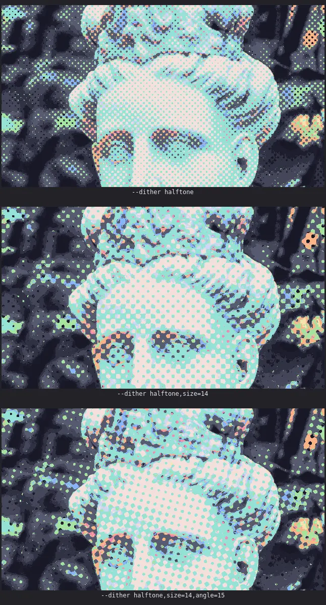

<!-- gen:ladder:wal-dither-halftone -->
```sh
# inputs: rehue wal -i assets/tamula-aura-garden-bust.webp -s catppuccin-mocha -o out
# size=8, angle=45, the defaults
rehue wal --harmonize 1 --dither halftone
rehue wal --harmonize 1 --dither halftone,size=14
rehue wal --harmonize 1 --dither halftone,size=14,angle=15
```
<!-- /gen:ladder:wal-dither-halftone -->

## pattern

**tiles**: `hatch` (default) or `lines`. `hatch` draws diagonal lines,
then crossing ones as the tone deepens: crosshatch. `lines` draws
horizontal rules, then the rules between them.

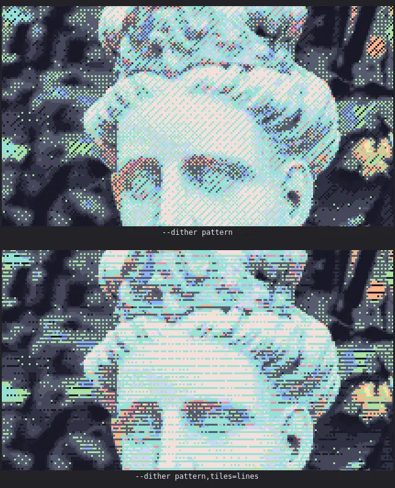

<!-- gen:ladder:wal-dither-tiles -->
```sh
# inputs: rehue wal -i assets/tamula-aura-garden-bust.webp -s catppuccin-mocha -o out
# tiles=hatch, the default
rehue wal --harmonize 1 --dither pattern
rehue wal --harmonize 1 --dither pattern,tiles=lines
```
<!-- /gen:ladder:wal-dither-tiles -->

## diffuse

**kernel**: `floyd-steinberg` (default) or `atkinson`. Floyd-Steinberg
passes on all of each pixel's difference: smooth, faithful tones.
Atkinson passes on three quarters, to more neighbors, so highlights
blow out and shadows block up: the bright, high-contrast look of early
Mac pictures. Diffusion has no grid, so it doesn't take `sample` or
`flat`.

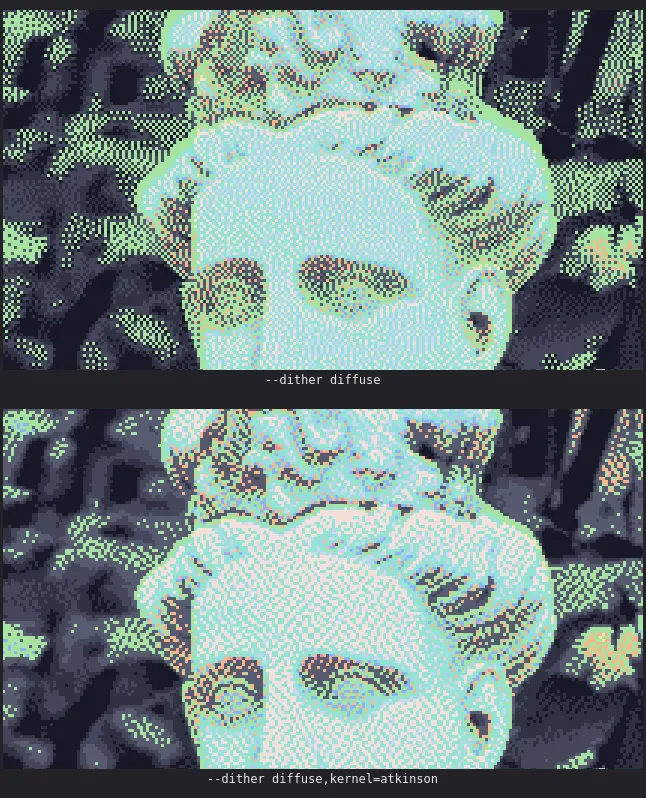

<!-- gen:ladder:wal-dither-kernel -->
```sh
# inputs: rehue wal -i assets/tamula-aura-garden-bust.webp -s catppuccin-mocha -o out
# kernel=floyd-steinberg, the default
rehue wal --harmonize 1 --dither diffuse
rehue wal --harmonize 1 --dither diffuse,kernel=atkinson
```
<!-- /gen:ladder:wal-dither-kernel -->

## Icons

`rehue icons --dither` dithers an icon theme too, with the same styles
and settings. It is best effort: an icon theme is mostly SVG, which
can't hold a pattern, so each icon is drawn at its folder's size (16,
24, 48 and so on, as the theme's `index.theme` lists them), dithered
with the scheme's colors, and written as a PNG in its place. Links to
it follow, and transparency is kept.

```sh
rehue icons -i Papirus-Dark -s catppuccin-mocha --dither
rehue icons -i Papirus-Dark -s catppuccin-mocha --dither diffuse,kernel=atkinson
```

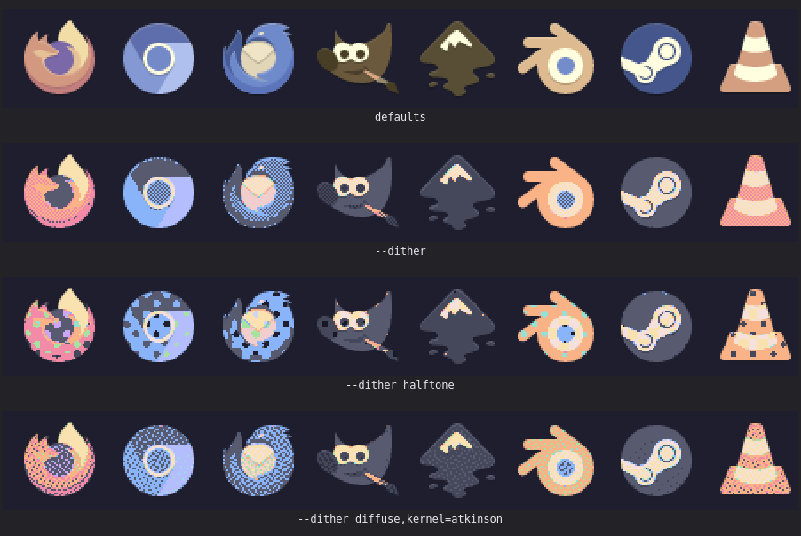

<!-- gen:ladder:icons-dither -->
```sh
# inputs: rehue icons -i Papirus-Dark -s catppuccin-mocha -o out
# recolored, no dither
rehue icons
rehue icons --dither
rehue icons --dither halftone
rehue icons --dither diffuse,kernel=atkinson
```
<!-- /gen:ladder:icons-dither -->

What changes in the theme:

- The icons no longer scale crisply: each size is a fixed set of
  pixels, so a desktop that scales an icon to a size the theme lacks
  blurs it.
- Soft edges keep their transparency, but the color under them is
  dithered like the rest.
- The theme grows (Papirus-Dark goes from links and SVGs to about
  400 MB of PNGs).
- Symbolic icons, which the toolkit colors itself, and icons in folders
  `index.theme` gives no size for stay recolored SVGs.
- With `--folders`, folder icons are dithered with the folder colors.
- `scale=auto` comes out at 1 for icons; a larger `scale` makes each
  pattern pixel cover several icon pixels.

## Notes

- `--palette` picks which colors dithering may use: two of them
  (`-p base00,base05`) give a two-ink picture.
- A `--dither` flag replaces a config's or look's `dither` whole,
  like `--palette`.
- `--lut` still works: the LUT holds the grade before dithering, since
  a dither depends on where a pixel is, not just its color.
- `report.json`'s coverage is exact with dithering: every pixel is one
  of the scheme's colors.
- A look's dither applies to wallpapers only: `rehue icons` dithers
  only when asked directly.

<!-- gen:flags:wal:dithering -->
| flag | value | what it does |
| --- | --- | --- |
| `--dither` | `STYLE[,K=V]` | Draw the result with the scheme's colors only, as a visible pattern: the 16-color game look. Bare = checker |
<!-- /gen:flags:wal:dithering -->

