# generate: a scheme from a wallpaper alone

`rehue scheme -g` makes a base16 scheme from a wallpaper, with no
scheme to start from:

```sh
rehue scheme -g -w my-photo.jpg -o generated
```

The wallpaper sets everything:

- **Neutrals** take the wallpaper's leading hue as their tint, and are
  as dark or as light as the picture's own ends.
- **Accents** come from the wallpaper's colors, by the method you pick
  (below), at a strength that follows how colorful the picture is: a
  quiet photo gives quiet accents, a vivid one vivid accents.
- **Every accent keeps 4.5:1 contrast** on the background, and base08
  (red) and base0B (green) stay apart for deuteranopes.

The examples on this page are generated from two wallpapers: a night
skyline video for a dark scheme, and a butterfly photo for a light one.
In each strip, the top row is the generated scheme and the bottom row
is the scheme after the flag (for the methods, both rows are the same:
no flag changes them).

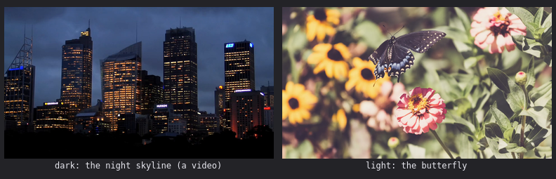

The same wallpaper always gives the same scheme. A run writes the same
files as any `rehue scheme` run, and `clusters.json` records the method
that ran and the colors it read.

## Dark or light

`--variant auto` (the default) makes a light scheme when the
wallpaper's median lightness is 0.6 or more, else a dark one. Pick one
yourself with `--variant dark` or `--variant light`:

```sh
rehue scheme -g -w my-photo.jpg --variant light
```

The scheme's `variant:` field says which it is.

## Methods

`-g` alone is `-g auto`, which runs `found` in this version. Name a
method to pick another:

```sh
rehue scheme -g distinct -w my-photo.jpg
rehue scheme -g rswal -w my-photo.jpg
```

| method | what the accents are |
| --- | --- |
| `found` | the wallpaper's colors, each in the slot its hue fits; empty slots get hues derived from them |
| `distinct` | the found and derived colors that fit best while keeping accents apart |
| `rswal` | the wallpaper's own colors, as pywal picks them, each in the slot nearest its usual color |
| `conventional` | the bundled schemes' usual accents |
| `image-hues` | every hue family in the wallpaper with its own lightness and chroma; gaps filled halfway between |
| `mono` | the leading hue in lightness and chroma steps |
| `analogous` | the leading hue and its neighbors 30° either side |
| `complementary` | the leading hue and its opposite |
| `split-complementary` | the leading hue and the two either side of its opposite |
| `triadic` | three hues 120° apart, in lightness and chroma steps |
| `triadic-fill` | three hues 120° apart, the gaps halved until there are eight |
| `square` | four hues 90° apart |

Dark, from the night skyline:

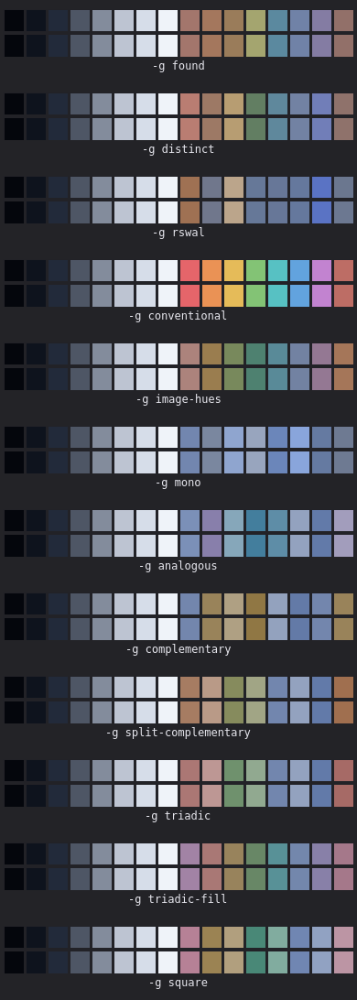

<!-- gen:ladder:generate-methods-dark -->
```sh
# inputs: rehue scheme -w assets/giang-city-skyline-night.mp4 --variant dark -o out
# the default (-g, auto)
rehue scheme -g found
rehue scheme -g distinct
rehue scheme -g rswal
rehue scheme -g conventional
rehue scheme -g image-hues
rehue scheme -g mono
rehue scheme -g analogous
rehue scheme -g complementary
rehue scheme -g split-complementary
rehue scheme -g triadic
rehue scheme -g triadic-fill
rehue scheme -g square
```
<!-- /gen:ladder:generate-methods-dark -->

Light, from the butterfly:

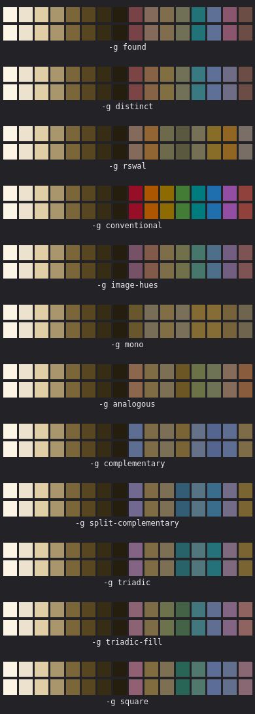

<!-- gen:ladder:generate-methods-light -->
```sh
# inputs: rehue scheme -w assets/kelly-ishmael-butterfly-closeup.webp --variant light -o out
# the default (-g, auto)
rehue scheme -g found
rehue scheme -g distinct
rehue scheme -g rswal
rehue scheme -g conventional
rehue scheme -g image-hues
rehue scheme -g mono
rehue scheme -g analogous
rehue scheme -g complementary
rehue scheme -g split-complementary
rehue scheme -g triadic
rehue scheme -g triadic-fill
rehue scheme -g square
```
<!-- /gen:ladder:generate-methods-light -->

base0F is a brown the wallpaper has where it has one, else a darker
base08.

A wallpaper with no color at all (black, white, gray) gets
`conventional` with untinted neutrals, whichever method you ask for;
the run says so.

## Match toward a scheme

`-M` (`--match`) pulls the generated scheme toward a target, 0 to 1. It
is 0 by default, so the scheme is the wallpaper's own.

### The wallpaper's own colors

Without `-i`, the target is the wallpaper's own hue families, and only
the accents move (the neutrals are already tinted from it):

```sh
rehue scheme -g -w my-photo.jpg -M 1
```

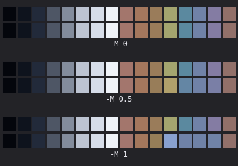

<!-- gen:ladder:generate-match-own-dark -->
```sh
# inputs: rehue scheme -g -w assets/giang-city-skyline-night.mp4 --variant dark -o out
# the default
rehue scheme -M 0
rehue scheme -M 0.5
rehue scheme -M 1
```
<!-- /gen:ladder:generate-match-own-dark -->

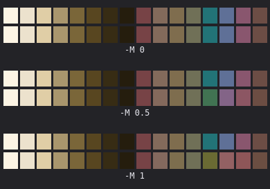

<!-- gen:ladder:generate-match-own-light -->
```sh
# inputs: rehue scheme -g -w assets/kelly-ishmael-butterfly-closeup.webp --variant light -o out
# the default
rehue scheme -M 0
rehue scheme -M 0.5
rehue scheme -M 1
```
<!-- /gen:ladder:generate-match-own-light -->

### Another scheme

With `-i`, the target is that scheme, slot to slot: each accent takes
the hue of the scheme's same slot (base0F toward its base0F), and each
neutral takes the same neutral's tint.

```sh
rehue scheme -g -w my-photo.jpg -i gruvbox-dark -M 0.5   # halfway to gruvbox
rehue scheme -g -w my-photo.jpg -i gruvbox-dark -M 1     # gruvbox's hues, the wallpaper's structure
```

Each strip starts with its target, to compare: gruvbox-dark for the
dark scheme, gruvbox-light for the light one.

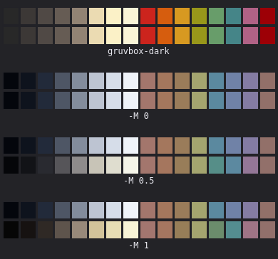

<!-- gen:ladder:generate-match-gruvbox-dark -->
```sh
# inputs: rehue scheme -g -w assets/giang-city-skyline-night.mp4 --variant dark -i gruvbox-dark -o out
# the default
rehue scheme -M 0
rehue scheme -M 0.5
rehue scheme -M 1
```
<!-- /gen:ladder:generate-match-gruvbox-dark -->

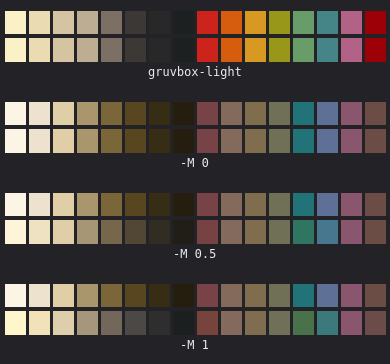

<!-- gen:ladder:generate-match-gruvbox-light -->
```sh
# inputs: rehue scheme -g -w assets/kelly-ishmael-butterfly-closeup.webp --variant light -i gruvbox-light -o out
# the default
rehue scheme -M 0
rehue scheme -M 0.5
rehue scheme -M 1
```
<!-- /gen:ladder:generate-match-gruvbox-light -->

### Lightness and chroma

`-M` moves hue. `--match-lightness` and `--match-chroma` pull the
lightness and chroma toward the target scheme's same slots, 0 to 1,
apart from it. Without `-M`, they keep the wallpaper's colors on the
target's lightness or chroma:

```sh
rehue scheme -g -w my-photo.jpg -i gruvbox-dark --match-lightness 1          # gruvbox's lightness, the wallpaper's colors
rehue scheme -g -w my-photo.jpg -i gruvbox-dark --match-chroma accents 1     # accents as vivid as gruvbox's
rehue scheme -g -w my-photo.jpg -i gruvbox-dark -M 1 --match-lightness 1 --match-chroma 1   # gruvbox, the wallpaper's tint
```

Both take a role, like the other grading dials (`--match-chroma
accents 1`), and need `-i`. Accents keep 4.5:1 on the background, so
an accent the target has lighter (or darker, in a light scheme) than
4.5:1 allows stops at it.

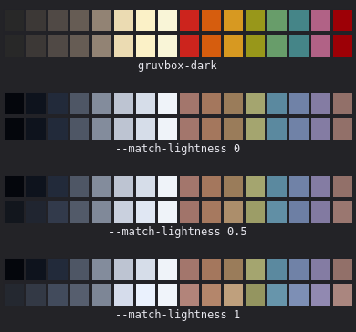

<!-- gen:ladder:generate-match-lightness-dark -->
```sh
# inputs: rehue scheme -g -w assets/giang-city-skyline-night.mp4 --variant dark -i gruvbox-dark -o out
# the default
rehue scheme --match-lightness 0
rehue scheme --match-lightness 0.5
rehue scheme --match-lightness 1
```
<!-- /gen:ladder:generate-match-lightness-dark -->

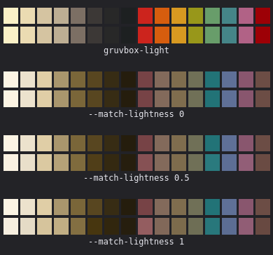

<!-- gen:ladder:generate-match-lightness-light -->
```sh
# inputs: rehue scheme -g -w assets/kelly-ishmael-butterfly-closeup.webp --variant light -i gruvbox-light -o out
# the default
rehue scheme --match-lightness 0
rehue scheme --match-lightness 0.5
rehue scheme --match-lightness 1
```
<!-- /gen:ladder:generate-match-lightness-light -->

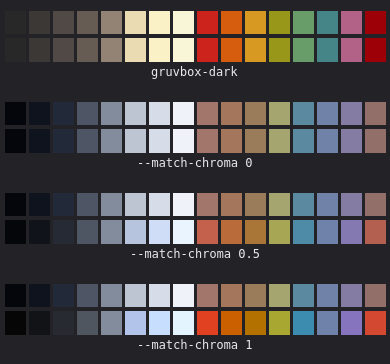

<!-- gen:ladder:generate-match-chroma-dark -->
```sh
# inputs: rehue scheme -g -w assets/giang-city-skyline-night.mp4 --variant dark -i gruvbox-dark -o out
# the default
rehue scheme --match-chroma 0
rehue scheme --match-chroma 0.5
rehue scheme --match-chroma 1
```
<!-- /gen:ladder:generate-match-chroma-dark -->

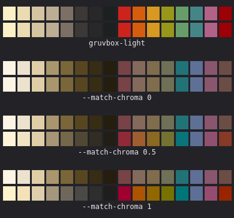

<!-- gen:ladder:generate-match-chroma-light -->
```sh
# inputs: rehue scheme -g -w assets/kelly-ishmael-butterfly-closeup.webp --variant light -i gruvbox-light -o out
# the default
rehue scheme --match-chroma 0
rehue scheme --match-chroma 0.5
rehue scheme --match-chroma 1
```
<!-- /gen:ladder:generate-match-chroma-light -->

### How far

`-M` sets match-hue and reach together: reach is 45° at 0 and grows to
180° at 1, so `-M 1` gives every accent a target hue. The accents keep
4.5:1 on the background through matching (unless you shift their
lightness with `--lightness`). `--match-hue` and
`--reach` set them separately, and win over `-M`. Halfway between
opposite tints, the neutrals pass through gray rather than through a
third hue.

## Nudge

Matching fully can land two accents on the same hue. `--nudge` pushes
near-identical accents apart, to just distinct, by lightness where
contrast allows, else by chroma:

```sh
rehue scheme -g -w my-photo.jpg -M 1 --nudge
```

## Even out the accents

`--chroma-even accents` pulls the accents' chroma toward their mean, 0
to 1, so none stands out as more or less vivid than the rest.
`--lightness-even accents` does the same for lightness; the accents
still keep 4.5:1 on the background. Any role works, as in
[scheme.md](scheme.md#every-grading-flag).

```sh
rehue scheme -g distinct -w my-photo.jpg --chroma-even accents 1
```

The examples use `distinct`, whose accents differ the most:

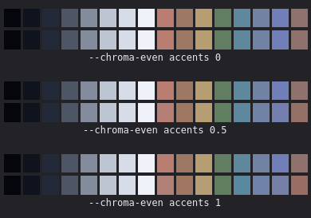

<!-- gen:ladder:generate-chroma-even-dark -->
```sh
# inputs: rehue scheme -g distinct -w assets/giang-city-skyline-night.mp4 --variant dark -o out
# the default
rehue scheme --chroma-even accents 0
rehue scheme --chroma-even accents 0.5
rehue scheme --chroma-even accents 1
```
<!-- /gen:ladder:generate-chroma-even-dark -->

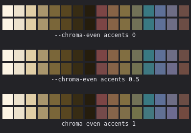

<!-- gen:ladder:generate-chroma-even-light -->
```sh
# inputs: rehue scheme -g distinct -w assets/kelly-ishmael-butterfly-closeup.webp --variant light -o out
# the default
rehue scheme --chroma-even accents 0
rehue scheme --chroma-even accents 0.5
rehue scheme --chroma-even accents 1
```
<!-- /gen:ladder:generate-chroma-even-light -->

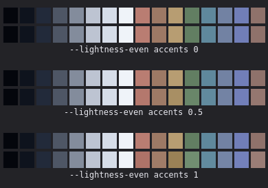

<!-- gen:ladder:generate-lightness-even-dark -->
```sh
# inputs: rehue scheme -g distinct -w assets/giang-city-skyline-night.mp4 --variant dark -o out
# the default
rehue scheme --lightness-even accents 0
rehue scheme --lightness-even accents 0.5
rehue scheme --lightness-even accents 1
```
<!-- /gen:ladder:generate-lightness-even-dark -->

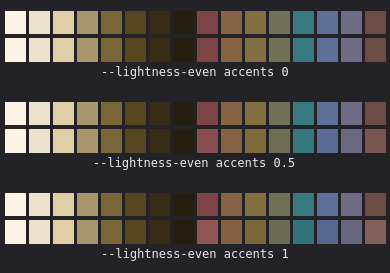

<!-- gen:ladder:generate-lightness-even-light -->
```sh
# inputs: rehue scheme -g distinct -w assets/kelly-ishmael-butterfly-closeup.webp --variant light -o out
# the default
rehue scheme --lightness-even accents 0
rehue scheme --lightness-even accents 0.5
rehue scheme --lightness-even accents 1
```
<!-- /gen:ladder:generate-lightness-even-light -->

## Save it

`--save NAME` also writes the scheme as `NAME.yaml` in your schemes
directory, `~/.config/rehue/schemes` (or `$XDG_CONFIG_HOME/rehue/schemes`,
or `--scheme-dir`), with its `name:` set to NAME. Every command finds it
by name from then on:

```sh
rehue scheme -g -w my-photo.jpg --save dusk
rehue wal -i my-photo.jpg -s dusk -H 1
rehue inspect -s dusk
```

If NAME is already saved, rehue asks before replacing it, and stops
when there's no terminal to ask in (a script, an `apply` pipeline).
`--replace` replaces it without asking:

```sh
rehue scheme -g -w new-photo.jpg --save dusk --replace
```

The author field is your username; the `author` config key sets
another. `--save` works without `-g` too, for a rehued scheme.

## Video

`-w` takes a video too: the scheme is made from frames across the
clip, each counting the same, so it fits the whole video.

## Everything else

The grading flags work on a generated scheme as on any other:
`--lightness`, `--chroma`, `--cycle`, `--assign` and the rest
([scheme.md](scheme.md#every-grading-flag)). `--assign` gives slots
hues from the wallpaper's families, and `--match-hue` says how much of
them they take, so with `-g` an `--assign` shows once match-hue is above
0.

<!-- gen:flags:scheme:generation -->
| flag | value | what it does |
| --- | --- | --- |
| `--generate` | `METHOD` | Generate the scheme from the wallpaper: a method, or `auto` (bare -g; found for now) |
| `--variant` | `auto \| dark \| light` | A generated scheme dark or light (default auto: light when the wallpaper's median lightness is 0.6 or more) |
| `--nudge` |  | Push near-identical accents apart, to just distinct (off by default) |
<!-- /gen:flags:scheme:generation -->

Each of these is a config key too (`generate`, `variant`, `nudge`,
`match`, `save`, `replace`, plus `author`); [config.md](config.md) covers the
format. In an [`apply` pipeline](apply.md), `generate` in
`[rehue.scheme]` makes the top-level `scheme` optional: the generated
scheme is what gets applied.
