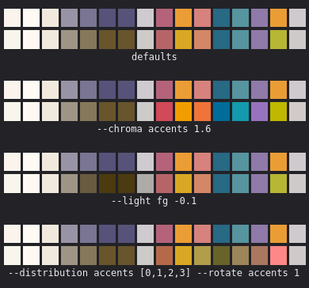
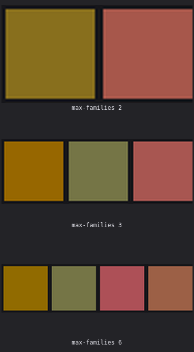

# Grading: roles and extraction

What both directions share: the roles a scheme's slots fall into, and
the extraction that finds a wallpaper's hue families.

The two commands are the same move pointed opposite ways.
[scheme](scheme.md) pulls the palette toward the picture.
[wal](wal.md) pushes the picture's pixels toward the palette.

## Roles

A base16 scheme's 16 slots fall into four **roles**. Each has a short
form for typing; rehue prints the full names:

<!-- gen:roles -->
| role | short | slots | what it is |
| --- | --- | --- | --- |
| `background` | `bg` | base00 | the background |
| `surfaces` | `sf` | base01-03 | panels, selections, comments |
| `foreground` | `fg` | base04-07 | text |
| `accents` | `ac` | base08-0F | syntax colors, highlights, status colors |
<!-- /gen:roles -->

Every dial can apply to everything, or to one role:

```sh
rehue scheme ... --chroma 1.2                  # every role
rehue scheme ... --chroma accents 1.6          # accents only
rehue scheme ... --chroma ac 1.6 --lightness fg 0.05   # short forms, one per role
```

Each row below is the butterfly mapped onto Rosé Pine Dawn (the
reference on top, the result below), with one role changed at a time:


<!-- gen:ladder:grading-groups -->
```sh
# inputs: rehue scheme -i rose-pine-dawn -w assets/kelly-ishmael-butterfly-closeup.webp -o out
rehue scheme
rehue scheme --chroma accents 1.6
rehue scheme --lightness foreground -0.1
rehue scheme --assign accents 0,1,2,3 --cycle accents 1
```
<!-- /gen:ladder:grading-groups -->

A role-specific setting always wins over the global one. In a
`--config` file an `all` record sets every role, and records for named
roles override it; [config.md](config.md) has the details.

## Extraction

Extraction finds the wallpaper's hue families: a chroma²-weighted hue
histogram, then a deterministic circular k-means (greedy histogram
seeding, fixed iteration count, no randomness). It feeds
`rehue scheme`'s mapping and `assign` on both sides.
[`rehue inspect`](inspect.md) shows what it found, with the index
`assign` refers to.

Extraction settings have no flags; they go in the `--config` file of
`scheme`, `wal` or `inspect`:

<!-- gen:extraction-table -->
| option | default | semantics |
| --- | --- | --- |
| `max-dimension` | 256 | work at this capped resolution (Lanczos resize) |
| `min-pixel-chroma` | 0.04 | ignore pixels below this chroma |
| `lightness-range` | [0.1, 0.92] | only pixels inside this lightness band vote |
| `max-families` | 6 | at most this many families survive |
| `seed-spacing` | 25 | histogram seeding: minimum separation between seeds |
| `iterations` | 30 | fixed k-means iteration count |
| `merge-within` | 18 | merge families closer than this |
| `min-family-weight` | 0.02 | drop families lighter than this mass |
| `min-accent-chroma` | 0.06 | a family must be at least this chromatic to claim an accent slot |
<!-- /gen:extraction-table -->

`max-families` narrowing what survives, on the butterfly (2 / 3 / 6).
The ladder runs `rehue inspect`, which shows the families as swatches:


<!-- gen:ladder:extract-max-families -->
```sh
# inputs: rehue inspect -w assets/kelly-ishmael-butterfly-closeup.webp -o out
# config.json: {"max-families":2}
rehue inspect --config config.json
# config.json: {"max-families":3}
rehue inspect --config config.json
# the default
# config.json: {"max-families":6}
rehue inspect --config config.json
```
<!-- /gen:ladder:extract-max-families -->
