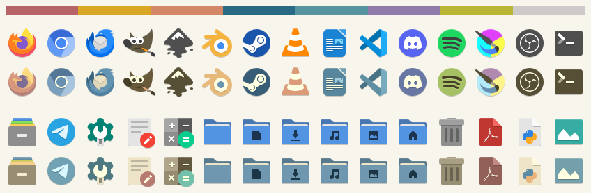
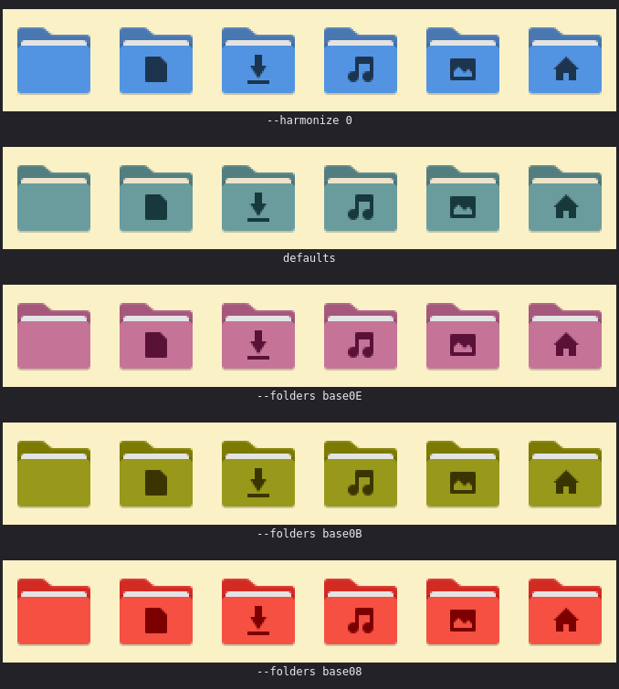
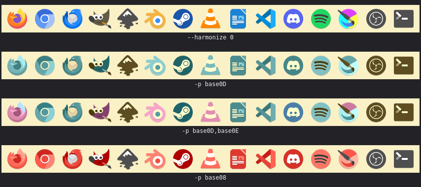

# icons: recolor an icon theme

`rehue icons` recolors a whole icon theme with your scheme. Every
color in the theme gets the same grade a wallpaper gets from
[wal](wal.md), so the icons, the wallpaper and the apps all land in
one palette.



## Recolor a theme

```sh
rehue icons -i Papirus -s gruvbox-light
cp -r rehue-out/Papirus-rehue ~/.local/share/icons/
```

Then pick `Papirus-rehue` in your desktop's icon settings (on
GNOME: `gsettings set org.gnome.desktop.interface icon-theme
Papirus-rehue`). `rehue-out/preview.png` shows familiar icons
before (upper rows) and after (lower rows), so you can judge the grade
first; `-n` writes nothing but the summary.

`-i` takes a theme name from your icon directories, a theme directory,
or a single `.svg` / `.png` icon. `--name` sets the new theme's name.
With Nix, [`lib.icons`](nix.md#icon-themes) builds the recolored theme
as a package.

## Set the folder color

`--folders` takes a scheme color (or several, weighted like `-p`) and
paints only the folder icons; everything else is graded as usual:

```sh
rehue icons -i Papirus -s gruvbox-light --folders base0E    # purple
rehue icons -i Papirus -s gruvbox-light --folders base0B    # green
```

Papirus's folders as it ships, graded with the rest of the theme, then
in three scheme colors:



<!-- gen:ladder:icons-folders -->
```sh
# inputs: rehue icons -i Papirus -s gruvbox-light -o out
# as Papirus ships
rehue icons --harmonize 0
# graded with the rest of the theme
rehue icons
rehue icons --folders base0E
rehue icons --folders base0B
rehue icons --folders base08
```
<!-- /gen:ladder:icons-folders -->

Folders are the theme's Places icons named `folder…`, plus the home
and desktop folders and the inode-directory icon.

`--folders` changes only the folders' colors; every other setting
grades the folders and the rest of the theme alike, so the folder
color combines with any grade in one run:

```sh
# graded with pop, folders purple (with pop's extra color too)
rehue icons -i Papirus -s gruvbox-light -l pop --folders base0E

# every icon in the scheme blue, folders purple
rehue icons -i Papirus -s gruvbox-light -p base0D --folders base0E
```

## Paint the icons in chosen colors

`-p` paints every icon in only the scheme colors you name, keeping its
own shading: one color for a monochrome pack, two for a duotone, or
as many as you like:

```sh
rehue icons -i Papirus -s gruvbox-light -p base0D           # one color
rehue icons -i Papirus -s gruvbox-light -p base0D,base0E    # two
```



<!-- gen:ladder:icons-palette -->
```sh
# inputs: rehue icons -i Papirus -s gruvbox-light -o out
# as Papirus ships
rehue icons --harmonize 0
# one color
rehue icons -p base0D
# two
rehue icons -p base0D,base0E
# red
rehue icons -p base08
```
<!-- /gen:ladder:icons-palette -->

## Pick a look

[Looks](looks.md) set the overall feel: `-l snap` puts every color
exactly on an accent and keeps whites white, `-l wash` leans every
icon toward the scheme's main accent colors, `-l pop` / `-l muted`
turn the color up or down. [looks.md](looks.md#built-in-looks) shows
every look on these icons. A look of your own can carry an `[icons]`
section; without one, its `[wal]` section grades the icons.

## Every grading flag

All of [wal's grading options](wal.md#options) work on icons, and icons
start from `harmonize` 1:

<!-- gen:flags:icons:grading -->
| flag | value | what it does |
| --- | --- | --- |
| `--folders` | `KEY[=W],...` | The folder color: which scheme colors folder icons are painted with, in the --palette form (a slot, a role, weights). Folders are the theme's Places icons named folder*, plus user-home, user-desktop and inode-directory; the rest of the theme is graded as usual |
| `--mode` | `blend \| snap` | How pixels find their palette color: `blend` = mix the nearby palette colors, weighted by hue distance (default); `snap` = take the nearest one |
| `--neutrals` | `floor \| mix` | What the scheme's grays (base00-07) do for colorful pixels: `floor` = only set the lowest chroma in blend, and never catch a color in snap, so the image keeps its color structure (default); `mix` = join in like any slot, a calmer cast faded toward the scheme's grays |
| `--harmonize` | `0..1` | How strongly to harmonize with the scheme, 0..1: sets match-hue and match-chroma wherever they aren't set (default 0) |
| `--match-hue` | `[ROLE] 0..1` | How much of the palette's hue each pixel takes on (0 = keep its own, 1 = fully adopt) |
| `--match-chroma` | `[ROLE] 0..1` | How much of the palette's chroma each pixel takes on (0 = keep its own, 1 = fully adopt) |
| `--match-lightness` | `[ROLE] 0..1` | How much of the palette's lightness each pixel takes on (default 0, which keeps the image photographic) |
| `--reach` | `DEG` | How far, in hue degrees, a palette color's pull extends (default 45) |
| `--palette` | `KEY[=W],...` | Which scheme colors pixels may be pulled toward, and how hard: slots (base0D), roles (ac) or all, comma-separated, each bare (weight 1) or KEY=WEIGHT |
| `--max-gray-chroma` | `C` | Below this chroma a pixel counts as gray (default 0.02) |
| `--cycle` | `[ROLE] N` | Move each of a role's hues N slots along, wrapping around (slots, not degrees) |
| `--lightness` | `[ROLE] L` | Lightness shift (added). Bare: the whole-image grade, applied last; with a role: that role's grade |
| `--chroma` | `[ROLE] C` | Chroma scale (multiplied). Bare: the whole-image grade, applied last; with a role: that role's grade |
<!-- /gen:flags:icons:grading -->

## Notes

- Only the theme you name is recolored. A theme that takes some icons
  from another one (Numix-Circle takes its folders from Numix) needs
  that one recolored too; rehue says so when it happens.
- SVG and PNG icons are recolored, including PNGs embedded in SVGs.
  Icons KDE colors at runtime keep following KDE there and take the
  scheme everywhere else.
- Links inside the theme stay links, so the result is about the size of
  the original. If GTK's gtk-update-icon-cache is installed, the icon
  cache is rebuilt.
