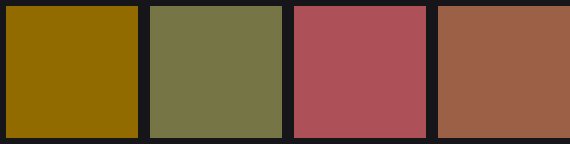

# inspect: see what rehue sees

`rehue inspect` shows you what rehue sees: a wallpaper's hue
families, a scheme's colors, every bundled scheme, or the looks.

**Wallpaper mode** lists the image's hue families with their index,
hue, chroma and weight, above a row of truecolor swatches in the same
order. The indices are what `assign` refers to. A video works too
(`-w my-loop.mp4`): its families are measured on frames across it,
through ffmpeg (`$REHUE_FFMPEG`, else your `PATH`).

<!-- gen:run:inspect-butterfly -->
```sh
rehue inspect \
  -w assets/kelly-ishmael-butterfly-closeup.webp \
  -o inspect
```
<!-- /gen:run:inspect-butterfly -->

The butterfly's four families, indices 0 to 3 left to right:



**Scheme mode** shows all 16 slots as truecolor swatches, four per
line, in canonical order:

```sh
rehue inspect -s gruvbox-light      # by name
rehue inspect -s my-theme.yaml      # by path
```

With `-o DIR`, wallpaper mode also writes `inspect.png` (the swatch
row) and scheme mode writes `inspect.png` (the 16 slots in a row) and
`preview.html` (the same mock page `scheme` produces).

**Looks mode** lists the [looks](looks.md), built-in and your own;
`rehue inspect --looks NAME` prints what one sets.

## Choosing a scheme

A scheme (`scheme -i`, `wal -s`, `icons -s`, `inspect -s`) is either a
**name** from the bundled collection (all <!-- gen:scheme-count -->375<!-- /gen:scheme-count -->
[tinted-theming](https://github.com/tinted-theming/schemes) base16
schemes, the same set Stylix uses) or a **path** to a scheme YAML.

To use your own collection, pass `--scheme-dir`: names are looked up
there first, then in the bundled set.

`rehue inspect --schemes` shows every scheme with its colors, so you
can pick by eye; `--schemes gruvbox` filters by name.
