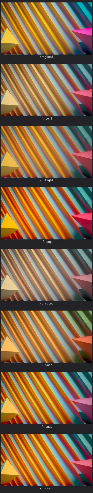
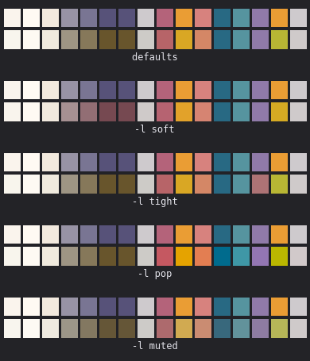
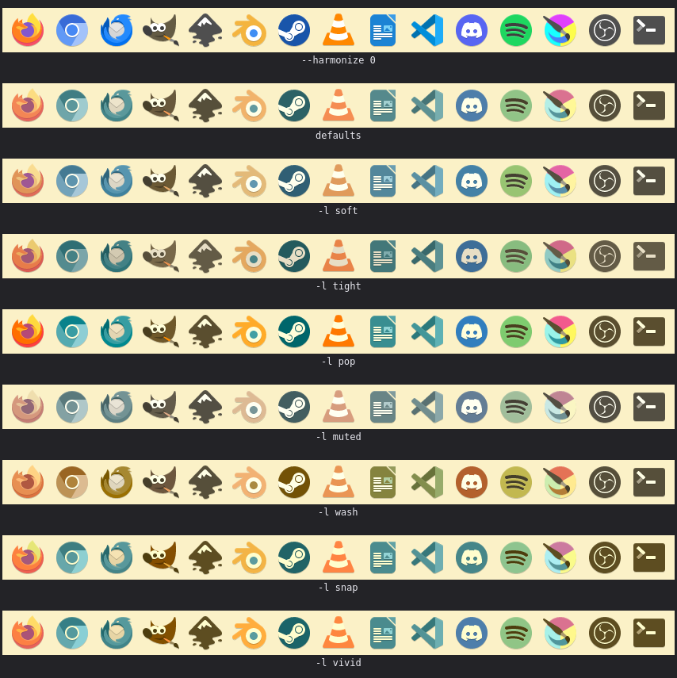

# Looks

A **look** is a saved grade you pick by name, so you don't have to
tune every dial yourself. The same `-l` (`--look`) works on `wal`,
`scheme` and `icons`:

```sh
rehue wal -i wall.png -s gruvbox-light -l pop
rehue scheme -i rose-pine-dawn -w wall.png -l soft
rehue icons -i Papirus -s gruvbox-light -l snap
rehue wal -i wall.png -s gruvbox-light -l snap,pop     # stacked, left to right
rehue inspect --looks                                  # list them
rehue inspect --looks pop                              # what one sets
```

## Built-in looks

<!-- gen:looks -->
| look | grades | what it does |
| --- | --- | --- |
| `soft` | wal, scheme, icons | calm: a gentle harmony with a soft cast toward the scheme's grays |
| `tight` | wal, scheme, icons | the closest bond: palette hue, chroma and some of its lightness; scheme accents follow every family |
| `pop` | wal, scheme, icons | full harmony with the color turned up |
| `muted` | wal, scheme, icons | full harmony, softer color: calm, low-saturation results |
| `wash` | wal, icons | the palette washed over the image: everything leans toward the scheme's main accent colors |
| `snap` | wal, icons | exact accent hues and chroma, the image's own shading kept |
| `vivid` | wal, icons | accents only, at full strength: bold color, grays left alone |
<!-- /gen:looks -->

Each cell below is one built-in look and nothing else.


<!-- gen:ladder:looks-wal -->
```sh
# inputs: rehue wal -i assets/bango-renders-3d-abstract.webp -s gruvbox-light -o out
rehue wal -l soft
rehue wal -l tight
rehue wal -l pop
rehue wal -l muted
rehue wal -l wash
rehue wal -l snap
rehue wal -l vivid
```
<!-- /gen:ladder:looks-wal -->

The looks that grade schemes too, on the butterfly and Rosé Pine Dawn:



<!-- gen:ladder:looks-scheme -->
```sh
# inputs: rehue scheme -i rose-pine-dawn -w assets/kelly-ishmael-butterfly-closeup.webp -o out
rehue scheme
rehue scheme -l soft
rehue scheme -l tight
rehue scheme -l pop
rehue scheme -l muted
```
<!-- /gen:ladder:looks-scheme -->

And on icons, Papirus with Gruvbox Light (a row of the
[icons](icons.md) preview each):



<!-- gen:ladder:looks-icons -->
```sh
# inputs: rehue icons -i Papirus -s gruvbox-light -o out
# as Papirus ships
rehue icons --harmonize 0
# no look: harmonize 1
rehue icons
rehue icons -l soft
rehue icons -l tight
rehue icons -l pop
rehue icons -l muted
rehue icons -l wash
rehue icons -l snap
rehue icons -l vivid
```
<!-- /gen:ladder:looks-icons -->

## Looks and your own settings

A look is a starting point: your `-c` config and your flags still win,
key by key (`-l pop --chroma 1` keeps pop's harmony but not its extra
color). Stacked looks layer left to right, each winning over the one
before. Configs and pipelines take `look` as a key too
(`"look": "pop"`); a `-l` flag replaces the config's look.
[config.md](config.md#merge-and-precedence) has the full order.

## Writing your own

Your own looks go in `~/.config/rehue/looks/`, one file per look,
named after it. Like a [config](config.md), a look can be TOML, YAML
or JSON (`dusk.toml`, `dusk.yaml`, `dusk.json`). A look has a
`description` and a section per command, `wal`, `scheme` and `icons`,
each taking the same keys as that command's config. A look without an
`icons` section grades icons with its `wal` one.

```toml
# ~/.config/rehue/looks/dusk.toml
description = "evening: quieter, a little darker"

[wal]
harmonize = 1
chroma = 0.8
lightness = -0.04

[scheme]
roles.all.chroma = 0.85
```

The same look in YAML:

```yaml
# ~/.config/rehue/looks/dusk.yaml
description: "evening: quieter, a little darker"
wal:
  harmonize: 1
  chroma: 0.8
  lightness: -0.04
scheme:
  roles:
    all:
      chroma: 0.85
```

Then `rehue wal -l dusk ...`. Keep one file per name: if `dusk.toml`
and `dusk.yaml` both exist, rehue asks you to remove one. A file named like a built-in replaces
it, and a name with a `/` is a path (`-l ./dusk.toml`).
`rehue inspect --looks` marks your own looks and the built-ins they
replace.
