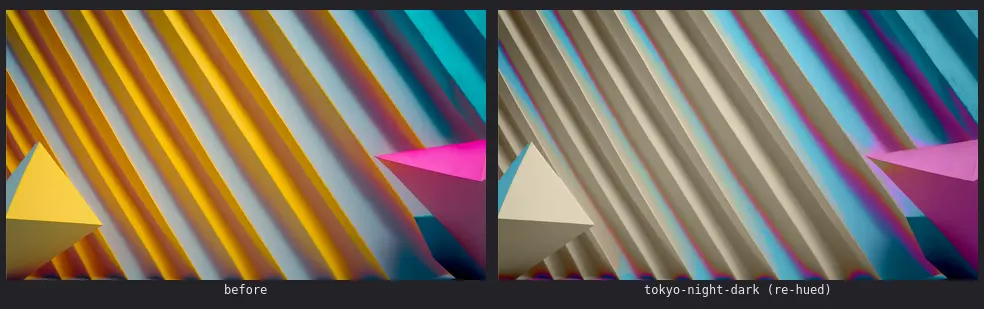
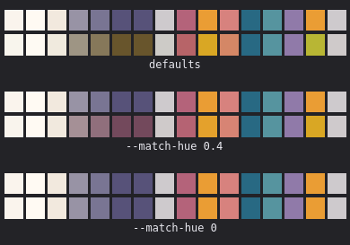
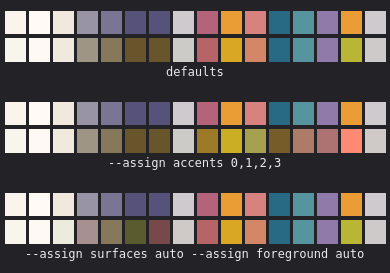
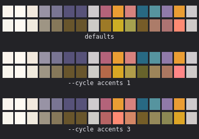
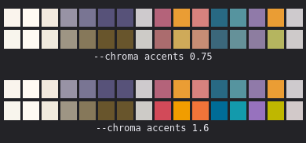
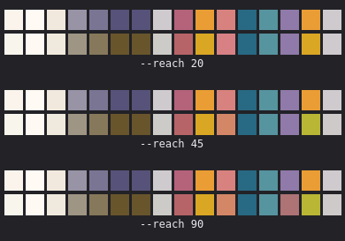

# scheme: rehue a scheme with a wallpaper

`rehue scheme` paints a base16 scheme with a wallpaper's colors. The
wallpaper decides which hues the scheme gets; the scheme keeps its own
lightness, chroma and contrast, so it stays as readable as it was.

Paint Tokyo Night Dark with the wallpaper's hues, at defaults:

<!-- gen:run:bango-mapped -->
```sh
rehue scheme \
  -i tokyo-night-dark \
  -w assets/bango-renders-3d-abstract.webp \
  -o mapped
```
<!-- /gen:run:bango-mapped -->

Scheme before (top) and after (bottom). Tokyo Night's structure is
kept; only the hues move:


Then feed the new scheme back into the image with [wal](wal.md):

<!-- gen:run:bango-repainted -->
```sh
rehue wal \
  -i assets/bango-renders-3d-abstract.webp \
  -s mapped/scheme.yaml \
  -o repainted \
  -H 1
```
<!-- /gen:run:bango-repainted -->



The palette your terminal uses is now the palette the picture was
painted with.

A run writes:

- `scheme.yaml`, the new scheme
- `preview.png`, the scheme before and after as swatch strips
- `preview.html`, the scheme on a mock desktop
- `clusters.json`, the wallpaper's hue families and the settings that
  found them

How rehue finds the wallpaper's hues is covered in
[extraction](grading.md#extraction); the [roles](grading.md#roles)
section explains the role argument many flags take.

## Options

Each option below has a ladder: one swatch strip per command, the
reference scheme on top and the result below, labelled with the flags
that made it. **The code block under each image is the recipe**, one
command per strip, and its first line names the inputs they run on.
The ladders paint Rosé Pine Dawn with the hue families of
[kelly-ishmael-butterfly-closeup](../assets/kelly-ishmael-butterfly-closeup.webp),
shown small here because the scheme strip is the subject:

<p></p>

### match-hue — `0..1`, default `1`

The whole point of `rehue scheme`: 1 = every slot adopts the mapped hue,
0 = the reference scheme verbatim. Between: the wallpaper's pull fades
by shortest-arc circular interpolation between the reference and
assigned hues.
(Note the direction difference from wal: there match-hue pulls pixels
*toward the scheme*; here slots pull *toward the wallpaper*.)



<!-- gen:ladder:scheme-match-hue -->
```sh
# inputs: rehue scheme -i rose-pine-dawn -w assets/kelly-ishmael-butterfly-closeup.webp -o out
# match-hue 1, the default
rehue scheme
rehue scheme --match-hue 0.4
# the reference scheme verbatim
rehue scheme --match-hue 0
```
<!-- /gen:ladder:scheme-match-hue -->

### assign — per role

Replaces the default assignment (accents claim eligible families by
hue distance; every other role adopts the heaviest family) with
explicit family targeting: the same `auto` / index / list values as
[wal](wal.md#assign--per-role). Family indices come from
[`rehue inspect`](inspect.md).



<!-- gen:ladder:scheme-assign -->
```sh
# inputs: rehue scheme -i rose-pine-dawn -w assets/kelly-ishmael-butterfly-closeup.webp -o out
# defaults: accents claim, the rest take the heaviest family
rehue scheme
rehue scheme --assign accents 0,1,2,3
# surfaces and foreground spread across the families
rehue scheme --assign surfaces auto --assign foreground auto
```
<!-- /gen:ladder:scheme-assign -->

### cycle — per role, integer

Applies after assign: the role's hues move N slots along.



<!-- gen:ladder:scheme-cycle -->
```sh
# inputs: rehue scheme -i rose-pine-dawn -w assets/kelly-ishmael-butterfly-closeup.webp -o out
rehue scheme --assign accents 0,1,2,3
rehue scheme --assign accents 0,1,2,3 --cycle accents 1
rehue scheme --assign accents 0,1,2,3 --cycle accents 3
```
<!-- /gen:ladder:scheme-cycle -->

### lightness / chroma — per role

Lightness shift (added) and chroma scale (multiplied) for the role's
slots; the scheme's structure stays unless you ask.



<!-- gen:ladder:scheme-chroma -->
```sh
# inputs: rehue scheme -i rose-pine-dawn -w assets/kelly-ishmael-butterfly-closeup.webp -o out
rehue scheme --chroma accents 0.75
rehue scheme --chroma accents 1.6
```
<!-- /gen:ladder:scheme-chroma -->

### reach — degrees, default `45`

The accent claim gate: how far a family hue may sit from an accent
slot's hue and still claim it. Widening lets more slots follow more
families; narrowing forces them back to the heaviest ones.



<!-- gen:ladder:scheme-reach -->
```sh
# inputs: rehue scheme -i rose-pine-dawn -w assets/kelly-ishmael-butterfly-closeup.webp -o out
rehue scheme --reach 5
# the default
rehue scheme --reach 45
rehue scheme --reach 180
```
<!-- /gen:ladder:scheme-reach -->

## Every grading flag

<!-- gen:flags:scheme:grading -->
| flag | value | what it does |
| --- | --- | --- |
| `--reach` | `DEG` | How far, in hue degrees, an accent can reach to claim a wallpaper hue (default 45) |
| `--assign` | `[ROLE] VAL` | Give a role's slots hues taken from the wallpaper's families: `auto` = spread the heaviest across, `3` = all from family 3, `0,2,5` = these families across the slots |
| `--cycle` | `[ROLE] N` | Move each of a role's hues N slots along, wrapping around (slots, not degrees) |
| `--match-hue` | `[ROLE] 0..1` | How much of the wallpaper's hue the slots take on, 0..1 (default 1) |
| `--lightness` | `[ROLE] L` | Shift a role's lightness (added; -0.1 is darker) |
| `--chroma` | `[ROLE] C` | Scale a role's chroma (multiplied; 0.8 muted, 1.3 vivid) |
<!-- /gen:flags:scheme:grading -->

The same settings go in a `--config` file, along with the
[extraction](grading.md#extraction) settings; [config.md](config.md)
covers the format and how settings combine.
