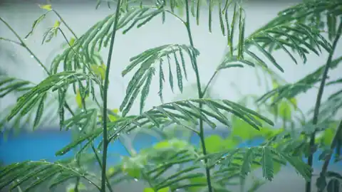

# Video

`rehue wal` takes a video wallpaper as well as a still: give `-i` a
video (`.mp4`, `.webm`, `.mkv` or `.mov`) and every frame goes through
the grade, with every option [wal.md](wal.md) covers. It needs
[ffmpeg](https://ffmpeg.org/download.html) and ffprobe: on your `PATH`,
named by `$REHUE_FFMPEG`, or given with `--ffmpeg` (ffprobe is looked
for beside it).

```sh
rehue wal -i clip.mp4 -s tokyo-night-storm -l pop -o graded
```

- The output keeps the input's container: `wallpaper.mp4` (H.264, as
  are `.mkv` and `.mov`) or `wallpaper.webm` (VP9), in full-resolution
  color when [dithered](#dithering-a-video). The audio comes across
  unchanged (to Opus for WebM, unless it is already).
- The grade is measured on 32 frames spread across the whole video and
  then applied to every frame the same way, so the colors hold steady
  when the light changes.
- `compare.png` shows the first frame, `report.json` counts coverage
  over every frame and adds a `video` section, and `preview.html`
  plays the result.
- The frames rehue hands ffmpeg are the same bytes every run; the
  encoded file also depends on your ffmpeg build.
- `--dither` draws every frame with the scheme's colors: see
  [Dithering a video](#dithering-a-video).

Play the result with any video wallpaper player, such as mpvpaper.

A skyline from dusk to night in Dawnfox, its sky kept clean with the
[banding](#banding-or-blotches) flags:

<!-- gen:run:video -->
```sh
rehue wal \
  -i assets/xiang-qi-chongqing-twilight.mp4 \
  -s dawnfox \
  -H 1 \
  --match-lightness 0.3 \
  --chroma 0.8 \
  --grays tint \
  --deband \
  --grain \
  -o graded
```
<!-- /gen:run:video -->

| | |
| --- | --- |
|  | <br>the clip's hue families |
|  | <br>dawnfox |

## Banding or blotches

A grade can make what a video's compression left behind easier to see.
Each fix is opt-in; try them by what you see:

- **Patches of color in a dark or gray sky** (olive here, pink there,
  where the original was plain gray): `--grays tint`. The grays take
  the scheme's tint instead of their own faint, noisy hue.
- **Blocky steps in skies and gradients**: `--deband`. ffmpeg smooths
  the compression's steps before the grade.
- **Steps that are still there**: `--grain`, fine grain over the
  result, which hides them (`--grain 2` for less, `--grain 6` for
  more; 4 by default). It moves frame to frame like film grain, and
  works on a still too.

```sh
rehue wal -i night.mp4 -s rose-pine-moon -H 1 --grays tint --deband --grain
rehue wal -i sunset.mp4 -s gruvbox-dark -H 1 --deband --grain 3
```

<!-- gen:flags:wal:banding -->
| flag | value | what it does |
| --- | --- | --- |
| `--deband` |  | Smooth a video's compression banding before grading: ffmpeg's deband filter, for blocky steps in skies and gradients |
| `--grain` | `AMOUNT` | Add fine grain after grading, AMOUNT levels of 255 (1..32, default 4), to hide what banding is left |
<!-- /gen:flags:wal:banding -->

## Dithering a video

`--dither` takes a video too, in any [style](dither.md): every frame
is drawn with the scheme's colors only. Checker, halftone and pattern
place their dots by where they are in the frame, so the pattern holds
still while the picture moves. Diffuse runs too, with a warning: its
dots move every frame, so it shimmers.

<!-- gen:run:video-dither -->
```sh
rehue wal \
  -i assets/nothing-ahead-plant-in-rain.mp4 \
  -s kanagawa \
  --dither halftone \
  -o dithered
```
<!-- /gen:run:video-dither -->

A plant in the rain in Kanagawa, in halftone dots:

| | |
| --- | --- |
|  | <br>the clip's hue families |
|  | <br>kanagawa |

Every style works on a video; [dither.md](dither.md) shows them all,
at their own pixels.

How it's encoded:

- H.264 (VP9 for `.webm`) with full-resolution color (`yuv444p`), so
  each dot keeps its color: the usual `yuv420p` stores color at half
  resolution and smears colored dots together.
- If your ffmpeg lacks that encoder, rehue says so and uses AV1 4:4:4
  (libaom) instead.
- While it encodes, rehue shows the frame count and the time left.
- `report.json`'s `video` section names the encoder.

The file's size, and the work of playing it, follow how fine the
pattern is. At 1080p, checker at `scale=auto` (3) comes to about
27 Mbps and `scale=4` to about 4; halftone, whose dots default to
`scale=1`, to about 70. A larger `scale` gives a chunkier look, a
smaller file and lighter playback:

```sh
rehue wal -i clip.mp4 -s kanagawa --dither checker,scale=4
rehue wal -i clip.mp4 -s kanagawa --dither halftone,scale=2
```

Playback: graphics hardware doesn't decode 4:4:4, so the player
decodes on the CPU. At 1080p that takes about a quarter of one fast
desktop core for checker and half for halftone, more on a laptop's
slower cores, and about four times as much at 4K. mpv-based players
such as mpvpaper play it, as do Chromium and Firefox on Linux.

On a laptop, where that costs battery:

- Pause the wallpaper when it's covered: `mpvpaper -p` pauses it while
  hidden, and `-a full` also when a window is fullscreen.
- Use a larger `scale`: checker at `scale=4` plays on less than half
  the CPU of `scale=auto`.
- Encode `yuv420p` (below) so the GPU decodes it, at the cost of some
  of the dots' color.

Other encodings, through [`--ffmpeg-args`](#encoding), trade the dots'
color, size, encoding time and playback against each other:

| `--ffmpeg-args` | dots kept at 1080p | size | encodes | decoded |
| --- | --- | --- | --- | --- |
| *(none: H.264 4:4:4)* | 99.1–99.9% | 1× | fast | on the CPU |
| `"-c:v libaom-av1 -cpu-used 6 -row-mt 1 -crf 20 -b:v 0 -pix_fmt yuv444p"` | 99.6–99.97% | 0.6–1.2× | about 5× slower | on the CPU, with 1.3–2× the work |
| `"-c:v libx264 -preset slow -crf 16 -pix_fmt yuv420p"` | 94.5–99.8% (colored dots blur) | 0.8–1.4× | fast | on the GPU, and plays almost anywhere |
| `"-c:v libx264rgb -crf 0 -pix_fmt rgb24"` | every one | very large | fast | on the CPU, by few players beyond mpv |

A checker loses little to `yuv420p` (98.8–99.8% kept); colored
halftone and pattern dots lose the most.

## Encoding

`--ffmpeg-args` hands ffmpeg your own encoding flags, quoted as one
argument, in place of rehue's codec settings (H.264 at crf 16, or VP9
at crf 20 for WebM; 4:4:4 with `--dither`):

```sh
# HEVC, smaller (hvc1 so QuickTime and Apple players take it)
rehue wal -i clip.mp4 -s nord -H 1 --ffmpeg-args "-c:v libx265 -crf 20 -preset slow -tag:v hvc1"
# AV1, about a third of the default's size
rehue wal -i clip.mp4 -s nord -H 1 --ffmpeg-args "-c:v libsvtav1 -crf 30"
# full-resolution color, for sharp color edges
rehue wal -i clip.mp4 -s nord -H 1 --ffmpeg-args "-pix_fmt yuv444p"
```

- rehue keeps the input, the stream mapping, the filters, the length
  and the container, so `-i`, `-map`, `-vf`, `-filter_complex`, `-t`,
  `-ss`, `-f` and the like are refused. The container still follows
  the input (`.mkv` takes the most codecs).
- `-pix_fmt` sets the pixel format rehue converts the frames to,
  `yuv420p` if not given; an RGB encoder such as `libx264rgb` needs
  `-pix_fmt rgb24`.
- Audio flags (`-c:a`, `-b:a`, `-an`) override rehue's audio choice.
- The flags are recorded in `report.json`'s `video` section.

<!-- gen:flags:wal:video -->
| flag | value | what it does |
| --- | --- | --- |
| `--ffmpeg` | `FFMPEG` | Path to ffmpeg, for a video wallpaper (-i clip.mp4, .webm, .mkv or .mov); else $REHUE_FFMPEG / $PATH |
| `--ffmpeg-args` | `ARGS` | Encoding flags for ffmpeg, in place of rehue's codec defaults (H.264 crf 16, or VP9 crf 20 for WebM; 4:4:4 with --dither) |
<!-- /gen:flags:wal:video -->

## inspect and scheme

[`rehue inspect -w`](inspect.md) and [`rehue scheme -w`](scheme.md)
take a video too, its hues measured on frames across it.
