# wal: repaint a wallpaper with a scheme

`rehue wal` repaints a wallpaper with a base16 scheme's palette. It
keeps the picture's lightness, so it stays a photograph, and moves its
colors toward the scheme's:

<!-- gen:run:glitter -->
```sh
rehue wal \
  -i assets/vidsplay-rainbow-glitter.webp \
  -s gruvbox-light \
  -o glitter \
  -H 1
```
<!-- /gen:run:glitter -->

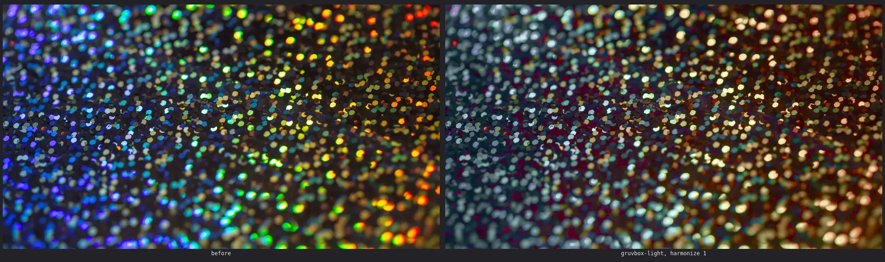

`--harmonize 1` (`-H 1`) moves the hue *and* chroma of every pixel
toward the palette, but leaves lightness alone, so the glitter keeps
its sparkle and trades its rainbow for Gruvbox's aqua, yellow and
orange. Its brightest specks reach the accents' full strength while
the dim ones stay quiet: the picture keeps its own range of color,
inside the scheme's.

It reads PNG, JPEG, WebP, GIF (the first frame), TIFF, BMP and QOI,
and video: MP4, WebM, MKV and MOV, graded frame by frame through
ffmpeg (see [Video](#video)). A run writes:

- `wallpaper.png`, the repainted image (`wallpaper.mp4` and so on for
  a video)
- `compare.png`, before/after thumbnails
- `report.json`, how much of the image each slot covers
- `preview.html`, the scheme on a mock desktop next to the result

With every dial at zero the output is the image re-encoded, unchanged.
[Looks](looks.md) are ready-made grades if you'd rather not set dials
yourself; the [roles](grading.md#roles) section explains the role
argument many flags take.

## Options

Each option below has a ladder: a montage that opens with the original
image, then one cell per command, labelled with the flags that made it.
**The code block under each montage is the recipe**, one command per
cell, and its first line names the inputs they run on.
The ladders repaint
[bango-renders-3d-abstract](../assets/bango-renders-3d-abstract.webp)
with Gruvbox Light, unless another image shows the option better.
Each applies only the option named, unless the option does nothing on
its own; then the recipe adds the companion dial it needs.

### harmonize — `0..1`, default `0`

The one-dial surface (`-H`): sets `match-hue` and `match-chroma`
wherever they are left unset. Explicit dials win (so `-H 1
--match-chroma 0.5` moves hue at full strength but chroma at half);
`match-lightness` is never set by it, so lightness stays photographic
unless you opt in by name.

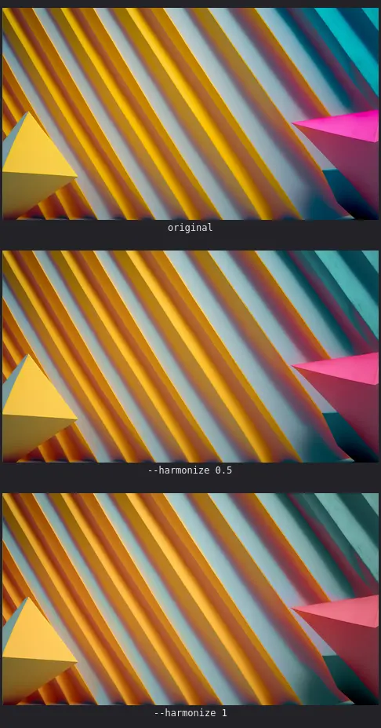

<!-- gen:ladder:wal-harmonize -->
```sh
# inputs: rehue wal -i assets/bango-renders-3d-abstract.webp -s gruvbox-light -o out
rehue wal --harmonize 0.5
rehue wal --harmonize 1
```
<!-- /gen:ladder:wal-harmonize -->

### mode — `blend | snap`, default `blend`

| | |
| --- | --- |
| `blend` | every pixel's target is a weighted mean under a smooth influence field (a Gaussian falloff on circular hue distance, lightness distance for gray pixels). Hue comes from the accents (base08-0F), so the scheme's grays never steer a color; chroma follows how colorful the pixel is within the image (see [match-chroma](#match-chroma--01-default-0-set-by-harmonize)). Slot boundaries become smooth crossings; the flat-constant posterize look disappears by construction. |
| `snap` | nearest-slot snapping: pixels adopt exact palette colors and flat constants, the stylized mode. Colorful pixels snap to the accents, gray ones to the grays (see [neutrals](#neutrals--floor-default--mix)). The match dials cut off at `reach`. |

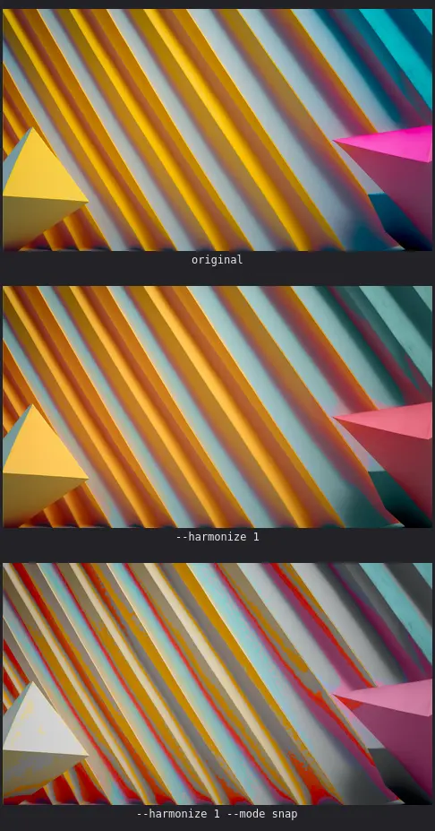

<!-- gen:ladder:wal-mode -->
```sh
# inputs: rehue wal -i assets/bango-renders-3d-abstract.webp -s gruvbox-light -o out
# blend (the default), harmonize 1
rehue wal --harmonize 1
# snap, harmonize 1
rehue wal --harmonize 1 --mode snap
```
<!-- /gen:ladder:wal-mode -->

### neutrals — `floor` (default) | `mix`

What the scheme's grays (base00-07) do for colorful pixels.
In `blend` with `floor`, they only set the lowest chroma: hue comes from the
accents and chroma follows how colorful each pixel is within its image
(see [match-chroma](#match-chroma--01-default-0-set-by-harmonize)), so
the picture keeps its color structure in the scheme's range. With
`mix`, they join the mix for hue and chroma like any slot: the image
takes on the scheme's overall cast, calmer and faded toward its grays.
`mix` is rehue's blend before 0.3, exactly; the `soft` look uses it.

In `snap` with `floor`, colorful pixels snap to the nearest accent
(base08-0F), never to a gray: a gray's hue is barely there, and a warm
or cool gray would otherwise catch the colors beside it and drain
them. With `mix`, every slot competes, as snap did before 0.3.

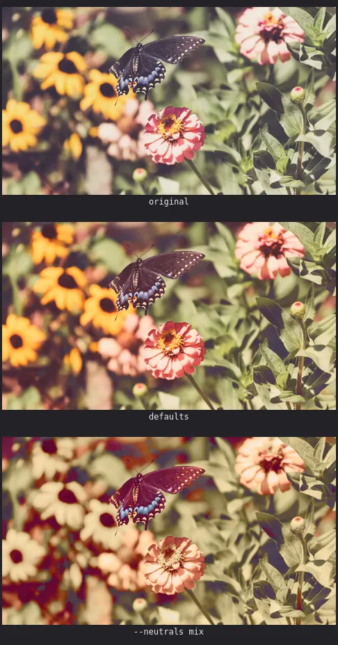

<!-- gen:ladder:wal-neutrals -->
```sh
# inputs: rehue wal -i assets/kelly-ishmael-butterfly-closeup.webp -s gruvbox-light -o out
# floor, the default
rehue wal --harmonize 1
rehue wal --harmonize 1 --neutrals mix
```
<!-- /gen:ladder:wal-neutrals -->

### match-hue — `0..1`, default `0` (set by harmonize)

How much of the target hue colorful pixels take on: 0 = their own hue,
1 = full adoption.

On its own it is subtle: a scheme's sixteen colors cover most of the
hue wheel, so the nearest one is usually only a few degrees away, and
most of what harmonize visibly does comes from match-chroma. Against a
narrow palette the pull is plain to see, so the ladder runs it with a
two-color `--palette` (see [palette](#palette--slots-roles-or-all-with-weights)).

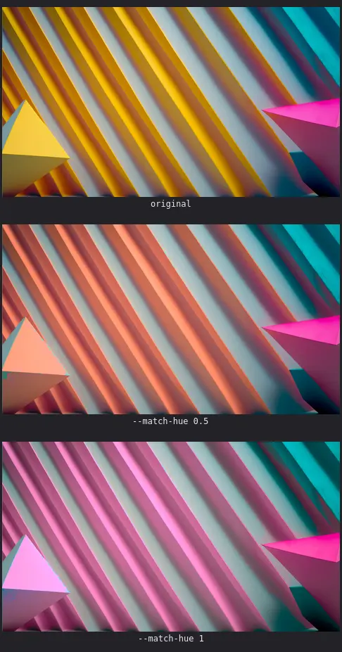

<!-- gen:ladder:wal-match-hue -->
```sh
# inputs: rehue wal -i assets/bango-renders-3d-abstract.webp -s gruvbox-light -o out
rehue wal --palette base0D,base0E --match-hue 0.5
rehue wal --palette base0D,base0E --match-hue 1
```
<!-- /gen:ladder:wal-match-hue -->

### match-chroma — `0..1`, default `0` (set by harmonize)

How much of the target chroma pixels take on. This is the dial that
carries the "repaint" feel; harmonize sets it along with match-hue.

In `blend`, the target depends on how colorful the pixel is **within
its image**: its chroma, against the image's most colorful areas (the
95th percentile), places it between the scheme's neutral chroma (the
average of base00-07) and its accents' chroma. Muted areas settle at
the scheme's neutral level, the way a themed desktop's surfaces do,
and the vivid details reach accent strength, so the picture keeps its
own saturation structure in the scheme's range. A `--palette` without
neutral slots (`-p ac`) gives every pixel accent strength. In `snap`,
the target is the nearest slot's own chroma.

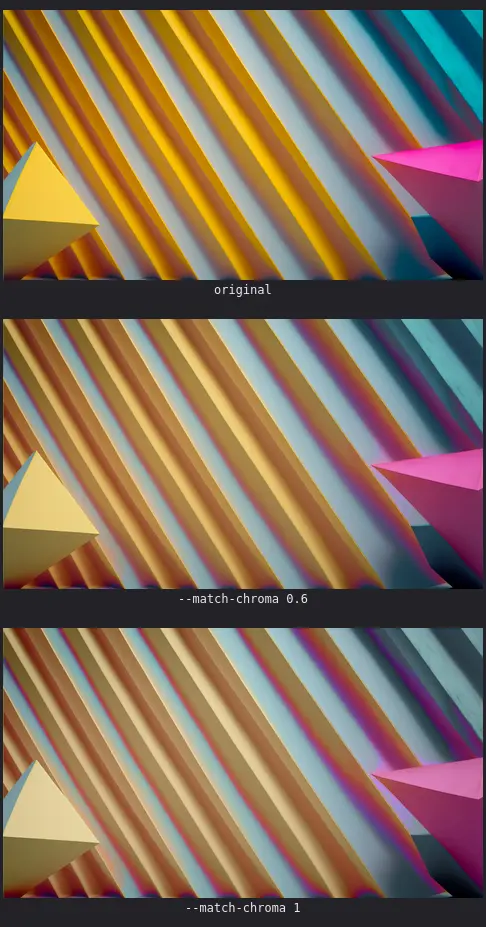

<!-- gen:ladder:wal-match-chroma -->
```sh
# inputs: rehue wal -i assets/vidsplay-rainbow-glitter.webp -s gruvbox-light -o out
rehue wal --match-chroma 0.5
rehue wal --match-chroma 1
```
<!-- /gen:ladder:wal-match-chroma -->

### match-lightness — `0..1`, default `0`, independent

How much of the target lightness pixels take on. Deliberately never
set by harmonize: adopting
lightness flattens contrast and washes the image out — visible in the
ladder below at 0.5 and 1.0. Default 0 keeps the picture's own
lightness shape at every harmonize level.

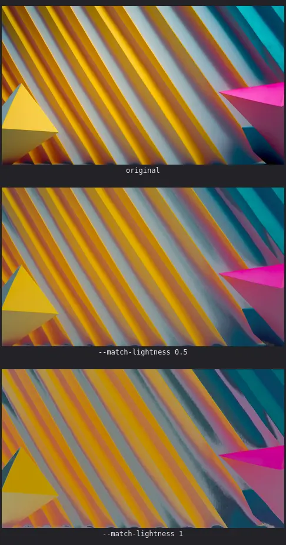

<!-- gen:ladder:wal-match-lightness -->
```sh
# inputs: rehue wal -i assets/bango-renders-3d-abstract.webp -s gruvbox-light -o out
rehue wal --match-lightness 0.5
rehue wal --match-lightness 1
```
<!-- /gen:ladder:wal-match-lightness -->

### reach — degrees, default `45`

How far influence reaches on the hue wheel: the lever for washing more
of the palette over the image. In `blend` mode it is the falloff width
(larger = farther slots pull on each pixel). Up to about 45 each color
keeps to its nearest accent; from about 90 neighboring accents blend
and the image leans toward the scheme's dominant accent colors; at 180
it is close to a tint in one blended accent hue (the `wash` look sits
at 120). With `neutrals mix` the wash goes toward the scheme's overall
cast instead, grays included. In `snap` it is the cutoff the match
dials use. Shown paired with a full `harmonize 1`, without which reach
changes nothing.

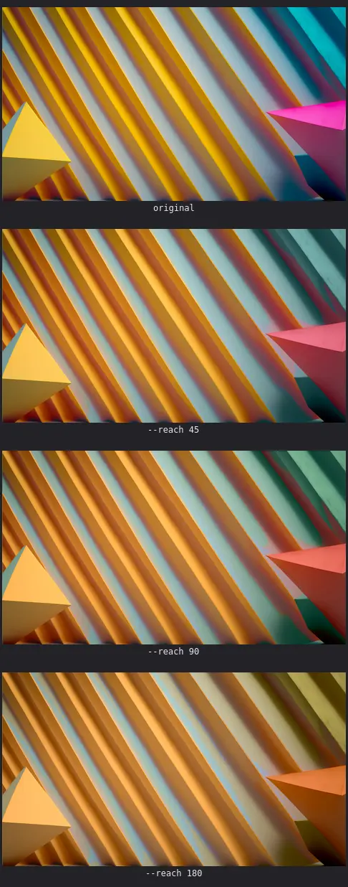

<!-- gen:ladder:wal-reach -->
```sh
# inputs: rehue wal -i assets/bango-renders-3d-abstract.webp -s gruvbox-light -o out
# the default
rehue wal --harmonize 1 --reach 45
rehue wal --harmonize 1 --reach 90
rehue wal --harmonize 1 --reach 180
```
<!-- /gen:ladder:wal-reach -->

### palette — slots, roles or `all`, with weights

Which scheme colors pixels may be pulled toward, and how hard. Keys
are slots (`base0D`), roles (`accents`, `ac`) or `all`; a bare key is
weight 1, `key=weight` sets it. Once a palette is given, **unlisted
slots are left out**, so `ac` means accents only (grays stay gray,
because no neutral slot is in), `base0D,base0E` is a duotone, and
`all,base0B=6` keeps everything but lets green reach farther. The
most specific key wins: a slot beats its role, a role beats `all`.

A weight divides the slot's hue distance, in both modes: a weight-2
slot pulls from twice as far in `blend` and claims an arc twice as
wide in `snap` (snap's `reach` cutoff still measures the real
distance). Weighting favors a color without taking the others away,
so it is gentler than leaving slots out. Weights belong to
slots, not hues: they apply after `assign` and `cycle`. In config:
`"palette": {"all": 1, "base0D": 6}`. A `--palette` flag replaces the
config's palette rather than merging with it.

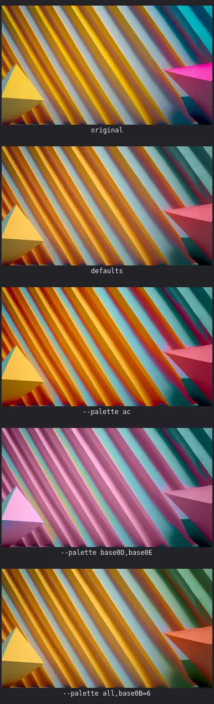

<!-- gen:ladder:wal-palette -->
```sh
# inputs: rehue wal -i assets/bango-renders-3d-abstract.webp -s gruvbox-light -o out
# every slot
rehue wal --harmonize 1
# accents only
rehue wal --harmonize 1 --palette ac
# duotone
rehue wal --harmonize 1 --palette base0D,base0E
# green reaches farther
rehue wal --harmonize 1 --palette all,base0B=6
```
<!-- /gen:ladder:wal-palette -->

### max-gray-chroma — default `0.02`

Chroma below which pixels count as gray: they key to the scheme's
low-chroma slots by lightness and keep their own hue (unless
[grays](#grays--keep-default--tint) is `tint`). From there up to twice
the value, pixels blend from gray to color, so a near-gray area such
as a night sky never splits into patches where its chroma crosses the
line. Raising it pulls pale pixels into the repainting earlier. Same
companion as reach: the effect only exists at nonzero match dials.
Shown on the butterfly, whose pale wings sit right around the
threshold.

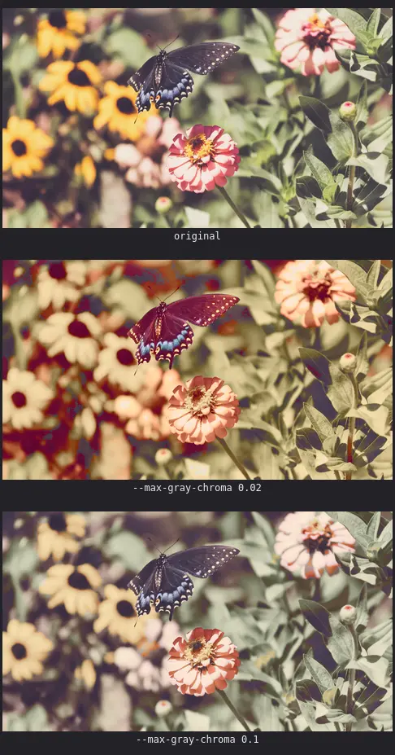

<!-- gen:ladder:wal-max-gray-chroma -->
```sh
# inputs: rehue wal -i assets/kelly-ishmael-butterfly-closeup.webp -s gruvbox-light -o out
# the default
rehue wal --harmonize 1 --max-gray-chroma 0.02
rehue wal --harmonize 1 --max-gray-chroma 0.1
```
<!-- /gen:ladder:wal-max-gray-chroma -->

### grays — `keep` (default) | `tint`

What hue gray pixels take on when they take on the scheme's chroma.
With `keep`, a gray keeps its own hue. With `tint`, it takes the hue
of the scheme's grays, as far as match-hue goes: here nord's cool
blue-gray replaces the photo's warm beige in the shadows and pale
petals, where with gruvbox whites go cream and with rose-pine
lavender. Use it where a gray's own faint hue would show
through, such as a night sky, or the gray parts of a one-color icon
pack.

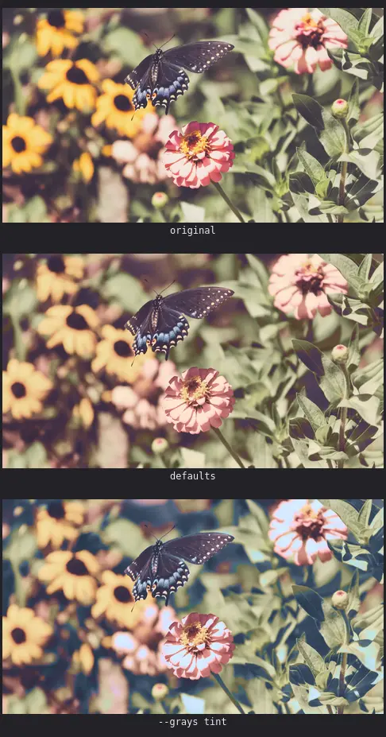

<!-- gen:ladder:wal-grays -->
```sh
# inputs: rehue wal -i assets/kelly-ishmael-butterfly-closeup.webp -s nord -o out
# keep, the default
rehue wal --harmonize 1
rehue wal --harmonize 1 --grays tint
```
<!-- /gen:ladder:wal-grays -->

### assign — per role

Before painting, gives the role's slots hues taken from the
wallpaper's families (lightness and chroma stay the scheme's).
Values: `auto` = the heaviest families spread across the role's
slots, `3` = every slot from family 3, `0,1,2,3` = explicit stops
(duplicates give flat runs; in a config, `"auto"`, `3` or `[0, 1, 2, 3]`).
Family indices come from [`rehue inspect`](inspect.md). Without a role only a family
index works: the single-slot background inherits `all`, so `auto` and
lists need a role. Shown on the glitter, whose many hues give the
families something to differ by.

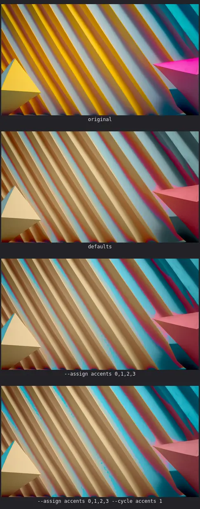

<!-- gen:ladder:wal-assign -->
```sh
# inputs: rehue wal -i assets/vidsplay-rainbow-glitter.webp -s gruvbox-light -o out
# no assign
rehue wal --harmonize 1
# every accent from the heaviest family
rehue wal --harmonize 1 --assign accents 0
# the four heaviest across the accents
rehue wal --harmonize 1 --assign accents 0,1,2,3
```
<!-- /gen:ladder:wal-assign -->

### cycle — per role, integer

Moves each of the role's hues N slots along, wrapping around (slots,
not degrees); no-op for the single-slot background. Applies after
assign. In wal it barely shows: pixels find their slot by hue, so
after a cycle the same hues still land on the same colors, and only
which lightness and chroma go with each hue changes (visible with
match-lightness). It matters on the scheme side, where it decides
which slot gets which color (see [scheme cycle](scheme.md#cycle--per-role-integer)).

### lightness / chroma — two depths

Bare: the **image-wide** grade, applied last (lightness added, chroma
multiplied). With a role (`--lightness bg -0.05`): that role's grade,
applied before the image-wide one.

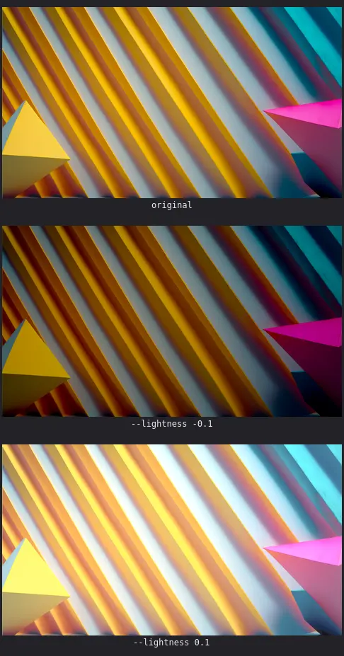

<!-- gen:ladder:wal-lightness -->
```sh
# inputs: rehue wal -i assets/bango-renders-3d-abstract.webp -s gruvbox-light -o out
rehue wal --lightness -0.1
rehue wal --lightness 0.1
```
<!-- /gen:ladder:wal-lightness -->

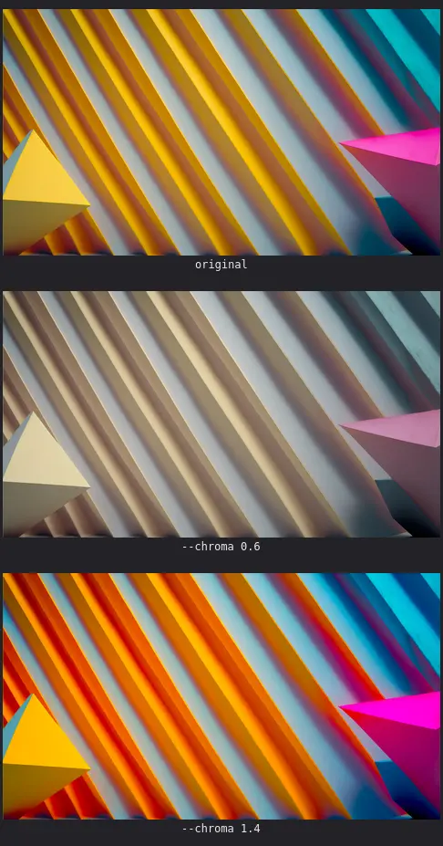

<!-- gen:ladder:wal-chroma -->
```sh
# inputs: rehue wal -i assets/bango-renders-3d-abstract.webp -s gruvbox-light -o out
rehue wal --chroma 0.6
rehue wal --chroma 1.4
```
<!-- /gen:ladder:wal-chroma -->

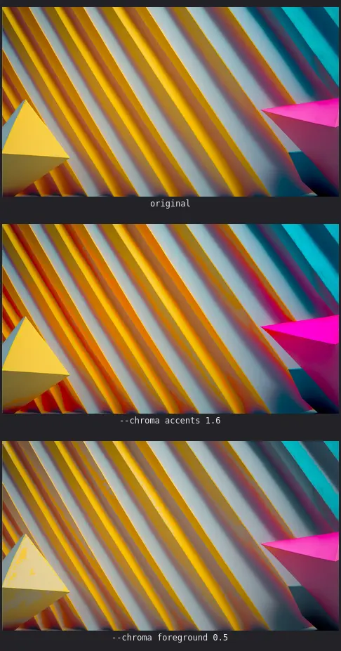

<!-- gen:ladder:wal-role-grades -->
```sh
# inputs: rehue wal -i assets/bango-renders-3d-abstract.webp -s gruvbox-light -o out
# harmonize alone
rehue wal --harmonize 1
rehue wal --harmonize 1 --chroma accents 2
rehue wal --harmonize 1 --lightness foreground 0.15
```
<!-- /gen:ladder:wal-role-grades -->

## Dithering

`--dither` draws the result with the scheme's colors only, as a
visible pattern: checkerboards, halftone dots, hatching or diffusion.
It runs last, after everything above.

```sh
rehue wal -i wall.png -s gruvbox-light --dither      # checker, the 16-color game look
rehue wal -i wall.png -s gruvbox-light -l pc98       # harmonize, then dither
```

[dither.md](dither.md) covers every style and setting, with examples.

## Video

Give `-i` a video (`.mp4`, `.webm`, `.mkv` or `.mov`) and every frame
goes through the grade. It needs
[ffmpeg](https://ffmpeg.org/download.html) and ffprobe: on your `PATH`,
named by `$REHUE_FFMPEG`, or given with `--ffmpeg` (ffprobe is looked
for beside it).

```sh
rehue wal -i clip.mp4 -s tokyo-night-storm -l pop -o graded
```

- The output keeps the input's container: `wallpaper.mp4` (H.264, as
  are `.mkv` and `.mov`) or `wallpaper.webm` (VP9). The audio comes
  across unchanged (to Opus for WebM, unless it is already).
- The grade is measured on 32 frames spread across the whole video and
  then applied to every frame the same way, so the colors hold steady
  when the light changes.
- `compare.png` shows the first frame, `report.json` counts coverage
  over every frame and adds a `video` section, and `preview.html`
  plays the result.
- The frames rehue hands ffmpeg are the same bytes every run; the
  encoded file also depends on your ffmpeg build.
- `--dither` doesn't take a video yet.

Play the result with any video wallpaper player, such as mpvpaper.

A skyline from dusk to night in Dawnfox, its sky kept clean with the
[banding](#banding-or-blotches) flags:

<!-- gen:run:wal-video -->
```sh
rehue wal \
  -i assets/xiang-qi-chongqing-twilight.mp4 \
  -s dawnfox \
  -H 1 \
  --match-lightness 0.3 \
  --chroma 0.8 \
  --grays tint \
  --deband \
  --grain \
  -o graded
```
<!-- /gen:run:wal-video -->

| | |
| --- | --- |
|  | <br>the clip's hue families |
|  | <br>dawnfox |

[`rehue inspect -w`](inspect.md) and [`rehue scheme -w`](scheme.md)
take a video too, its hues measured on frames across it.

### Banding or blotches

A grade can make what a video's compression left behind easier to see.
Each fix is opt-in; try them by what you see:

- **Patches of color in a dark or gray sky** (olive here, pink there,
  where the original was plain gray): `--grays tint`. The grays take
  the scheme's tint instead of their own faint, noisy hue.
- **Blocky steps in skies and gradients**: `--deband`. ffmpeg smooths
  the compression's steps before the grade.
- **Steps that are still there**: `--grain`, fine grain over the
  result, which hides them (`--grain 2` for less, `--grain 6` for
  more; 4 by default). It moves frame to frame like film grain, and
  works on a still too.

```sh
rehue wal -i night.mp4 -s rose-pine-moon -H 1 --grays tint --deband --grain
rehue wal -i sunset.mp4 -s gruvbox-dark -H 1 --deband --grain 3
```

<!-- gen:flags:wal:banding -->
| flag | value | what it does |
| --- | --- | --- |
| `--deband` |  | Smooth a video's compression banding before grading: ffmpeg's deband filter, for blocky steps in skies and gradients |
| `--grain` | `AMOUNT` | Add fine grain after grading, AMOUNT levels of 255 (1..32, default 4), to hide what banding is left |
<!-- /gen:flags:wal:banding -->

<!-- gen:flags:wal:video -->
| flag | value | what it does |
| --- | --- | --- |
| `--ffmpeg` | `FFMPEG` | Path to ffmpeg, for a video wallpaper (-i clip.mp4, .webm, .mkv or .mov); else $REHUE_FFMPEG / $PATH |
<!-- /gen:flags:wal:video -->

## LUT export

`--lut hald` (or `--lut cube`) also bakes the grade into a 3D lookup
table, `lut.png` (Hald CLUT) or `lut.cube`, so other tools can apply
exactly the same grade to other images or to video:

```sh
rehue wal -i wall.webp -s mapped/scheme.yaml -o graded \
  -H 1 --lut hald --lut-level 16

magick photo.jpg graded/lut.png -hald-clut photo-graded.jpg          # ImageMagick
ffmpeg -i clip.mp4 -i graded/lut.png -filter_complex '[0][1]haldclut' out.mp4   # ffmpeg
```

`--lut-level` sets the resolution (default 8, i.e. 64 points per
channel; `.cube` goes up to 8). At level 16 the Hald LUT covers every
8-bit color, and ImageMagick reproduces rehue's own output pixel for
pixel; lower levels are interpolated by the tool applying them. With
`--dither`, the LUT holds the grade before dithering: a dithered pixel
depends on its position, not just its color, so no LUT can hold it.

<!-- gen:flags:wal:lut-export -->
| flag | value | what it does |
| --- | --- | --- |
| `--lut` | `hald \| cube` | Also bake the grade into a 3D LUT: `lut.png` (Hald CLUT) or `lut.cube` |
| `--lut-level` | `2..16` | LUT resolution as a Hald level, 2..16 (16 = every 8-bit color, exact; `.cube` goes up to 8) (default 8) |
<!-- /gen:flags:wal:lut-export -->

## Every grading flag

<!-- gen:flags:wal:grading -->
| flag | value | what it does |
| --- | --- | --- |
| `--mode` | `blend \| snap` | How pixels find their palette color: `blend` = mix the nearby palette colors, weighted by hue distance (default); `snap` = take the nearest one |
| `--neutrals` | `floor \| mix` | What the scheme's grays (base00-07) do for colorful pixels: `floor` = only set the lowest chroma in blend, and never catch a color in snap, so the image keeps its color structure (default); `mix` = join in like any slot, a calmer cast faded toward the scheme's grays |
| `--grays` | `keep \| tint` | What hue gray pixels take on: `keep` their own (default), or `tint` with the scheme's grays, as far as match-hue goes |
| `--harmonize` | `0..1` | How strongly to harmonize with the scheme, 0..1: sets match-hue and match-chroma wherever they aren't set (default 0) |
| `--match-hue` | `[ROLE] 0..1` | How much of the palette's hue each pixel takes on (0 = keep its own, 1 = fully adopt) |
| `--match-chroma` | `[ROLE] 0..1` | How much of the palette's chroma each pixel takes on (0 = keep its own, 1 = fully adopt) |
| `--match-lightness` | `[ROLE] 0..1` | How much of the palette's lightness each pixel takes on (default 0, which keeps the image photographic) |
| `--reach` | `DEG` | How far, in hue degrees, a palette color's pull extends (default 45) |
| `--palette` | `KEY[=W],...` | Which scheme colors pixels may be pulled toward, and how hard: slots (base0D), roles (ac) or all, comma-separated, each bare (weight 1) or KEY=WEIGHT |
| `--max-gray-chroma` | `C` | Below this chroma a pixel counts as gray (default 0.02) |
| `--cycle` | `[ROLE] N` | Move each of a role's hues N slots along, wrapping around (slots, not degrees) |
| `--lightness` | `[ROLE] L` | Lightness shift (added). Bare: the whole-image grade, applied last; with a role: that role's grade |
| `--chroma` | `[ROLE] C` | Chroma scale (multiplied). Bare: the whole-image grade, applied last; with a role: that role's grade |
| `--assign` | `[ROLE] VAL` | Before painting, give a role's slots hues taken from the wallpaper's families: `auto` = spread the heaviest across, `3` = all from family 3, `0,2,5` = these families across the slots |
<!-- /gen:flags:wal:grading -->

The same settings go in a `--config` file; [config.md](config.md)
covers the format and how settings combine.
